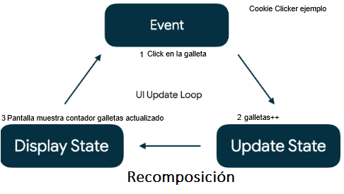
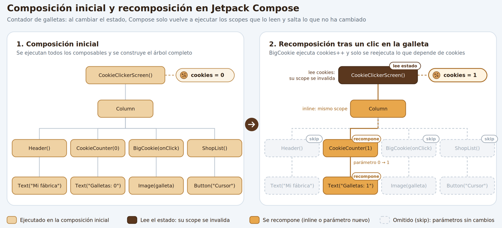
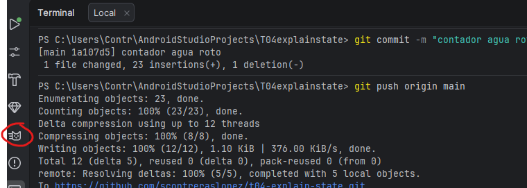
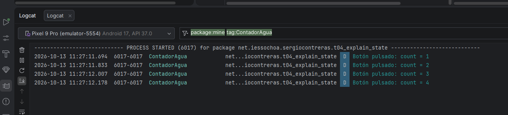
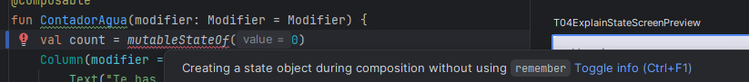
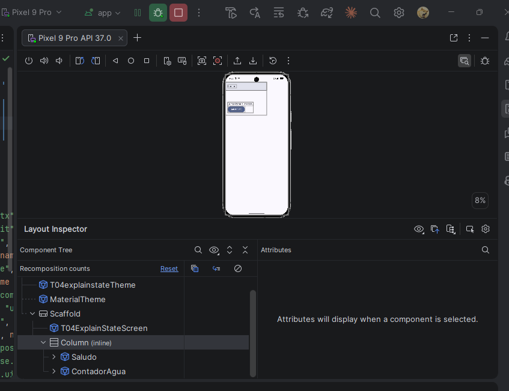
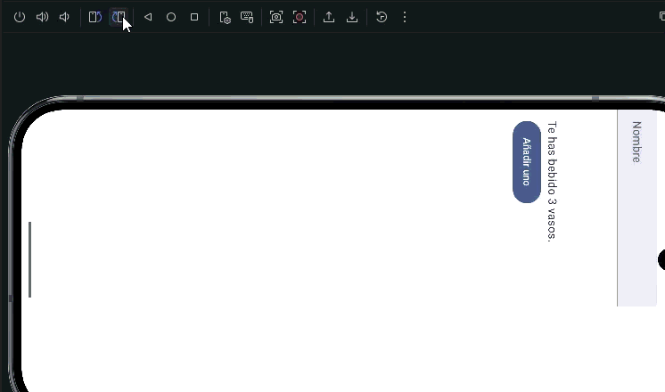

# T04 · Estado, TextField, Elevación de Estado, Switch, RadioButton

## Índice

- [Introducción](#introducción)
- [1. ¿Qué es el estado?](#1-qué-es-el-estado)
  - [Eventos](#eventos)
- [2. Composición y recomposición](#2-composición-y-recomposición)
  - [Dos experimentos fallidos](#dos-experimentos-fallidos)
  - [Comprobar valores con Logcat](#comprobar-valores-con-logcat)
- [3. Guardar el estado con mutableStateOf y remember](#3-guardar-el-estado-con-mutablestateof-y-remember)
- [4. UI dirigida por el estado](#4-ui-dirigida-por-el-estado)
- [5. Sobrevivir a la rotación con rememberSaveable](#5-sobrevivir-a-la-rotación-con-remembersaveable)
- [6. Composables con y sin estado](#6-composables-con-y-sin-estado)
- [7. Elevación de estado (state hoisting)](#7-elevación-de-estado-state-hoisting)
- [8. Aplicándolo a componentes](#8-aplicándolo-a-componentes)
  - [TextField](#textfield)
  - [Switch](#switch)
  - [Checkbox](#checkbox)
  - [RadioButton](#radiobutton)
- [9. Estado en listas](#9-estado-en-listas)
- [10. Hacia el ViewModel](#10-hacia-el-viewmodel)
- [11. Errores frecuentes](#11-errores-frecuentes)
- [12. Para practicar](#12-para-practicar)
- [Auto import](#auto-import)
- [Ejercicio 1 (práctica guiada): calculadora de propinas](#ejercicio-1-práctica-guiada-calculadora-de-propinas)
- [Ejercicio 2 (práctica guiada): propina personalizada](#ejercicio-2-práctica-guiada-propina-personalizada)
  - [Mantener el estado ante reconstrucciones](#mantener-el-estado-ante-reconstrucciones)
- [Ejercicio 3 (entregable): calculadora 🚨](#ejercicio-3-entregable-calculadora-)

## Introducción

Hemos visto cómo diseñar una pantalla estática mediante Compose, pero el usuario tendrá que interactuar con la App introduciendo datos y seleccionando opciones. Veremos cómo tendremos que mantener el estado de las diferentes opciones del usuario para trabajar con Compose. **Es muy importante** asimilar el patrón necesario para trabajar con estados de los diferentes elementos Composables.

Vamos a seguir los codeLabs de Google, pero tenemos información más completa en los siguientes artículos.

De la fantástica web de Develou empezaremos los siguientes artículos que nos explican algunos de los componentes UI más básicos:

- **TextField**: [https://www.develou.com/android-textfield-en-compose/](https://web.archive.org/web/20251116102540/https://www.develou.com/android-textfield-en-compose/)
- **Estado**: [https://www.develou.com/android-estado-en-compose/](https://web.archive.org/web/20251116102540/https://www.develou.com/android-estado-en-compose/)
- **Switch**: [https://www.develou.com/android-switch-en-compose/](https://web.archive.org/web/20251116102540/https://www.develou.com/switch-en-compose/)

Simplemente recordar que en la siguiente URL [Develou Android Main](https://web.archive.org/web/20251017050944/https://www.develou.com/android/) tenemos un índice de todos los artículos relacionados con Android de Develou.

> [!NOTE]
> La web de develou ya está KO, y estamos tirando de la copia de seguridad que tenemos en el Wayback Machine. Puede que algunos enlaces no funciones, que algunas imágenes no se vean o que algunos artículos estén incompletos. En cualquier caso, es un recurso muy valioso para aprender Android y Compose. Está identificado y se intentará sustituir por contenido propio o de otras fuentes oficiales (Google, JetBrains, etc.) a medida que se vaya encontrando contenido equivalente. En este caso la información de este tema es suficiente para poder realizar los ejercicios y aprender el patrón de trabajo con estados en Compose, sin necesidad de tener que leer los artículos de Develou.

Complementaremos las lecturas con el siguiente artículo oficial de Google:

- [Jetpack Compose State](https://developer.android.com/jetpack/compose/state)

Y ahora si ya el codelab oficial de Google:

- [Codelab: State in Jetpack Compose](https://developer.android.com/codelabs/jetpack-compose-state)

> [!IMPORTANT]
> **En este tema solo se entrega el [Ejercicio 3: la calculadora](#ejercicio-3-entregable-calculadora-).**
>
> Los ejercicios 1 y 2 son **prácticas guiadas** a partir de los *codelabs* de Google y **no se entregan**. Aun así, hazlos en orden: introducen el `TextField`, el `Switch` y la elevación de estado que necesitarás para la calculadora.

## 1. ¿Qué es el estado?

Un **estado** dentro de una app es cualquier dato que puede cambiar con el tiempo. Esta definición es muy amplia y abarca desde una variable de una clase hasta una base de datos Room. Todas las apps para Android muestran un estado al usuario.

Estos son algunos ejemplos de estado de las apps para Android:

- El texto que hay escrito en un campo de texto.
- Si se está mostrando un indicador de "cargando" o un mensaje de error.
- Los mensajes más recientes recibidos en una app de chat.
- La posición de desplazamiento en una lista de elementos.

> [!NOTE]
> **Idea clave:** El estado determina qué se muestra en la UI en un momento determinado.

### Eventos

Los eventos son entradas generadas desde el interior o el exterior de una App, como las siguientes:

- El usuario interactúa con la UI: pulsa un botón, escribe en un campo de texto, hace scroll en la pantalla...
- Otros factores, como los sensores que envían un valor nuevo o las respuestas de la red...

Si el estado representa aquello que se muestra en la UI, los eventos son el mecanismo de transición entre estados. Por ejemplo, cuando el usuario pulsa un botón se genera un evento que cambia el estado de la App y, a continuación, la UI se actualiza para reflejar el nuevo estado.

> [!NOTE]
> **Idea clave:** El estado **es**, el evento **sucede**.

En todas las apps para Android hay un bucle de actualización principal de la UI:

1. **Evento:** el usuario o alguna otra parte del programa genera un evento.
2. **Actualizar el estado:** un controlador de eventos cambia el estado que usa la UI.
3. **Mostrar el estado:** se actualiza la UI para mostrar el estado nuevo.



En Compose, ese tercer paso tiene nombre propio: **recomposición**.

## 2. Composición y recomposición

Compose es **declarativo**. En el sistema clásico de vistas de Android, para cambiar un texto buscabas el widget y llamabas a `setText()`. En Compose no existe nada parecido: un composable no se "modifica", se **vuelve a llamar con datos nuevos** y describe de nuevo cómo debe verse la UI.

Para hablar de esto con propiedad necesitamos tres términos:

- **Composición:** la descripción de la UI que construye Compose al ejecutar los composables. Ejemplo: un `Text` con un contador de galleta y un `Button` para añadir una galleta.
- **Composición inicial:** la primera vez que se ejecutan los composables para crear esa composición. Ejemplo: el contador de galleta empieza en `0`.
- **Recomposición:** volver a ejecutar los composables afectados cuando cambian los datos, para actualizar la composición. Ejemplo: Se añade una galleta y el contador pasa de `0` a `1`. Este composable se recompone y la composición se actualiza.

Si vienes del desarrollo web, es un concepto muy parecido al renderizado de React.

Compose no repite toda la pantalla en cada cambio: solo recompone los composables que **leen** el estado que ha cambiado. Es lo que se conoce como **recomposición inteligente**.



### Dos experimentos fallidos

Antes de ver la solución, conviene entender el problema. Prueba este `TextField`:

```kotlin
@Composable
fun Saludo(modifier: Modifier = Modifier) {
    TextField(
        value = "",
        onValueChange = { },
        label = { Text("Nombre") },
        modifier = modifier
    )
}
```

Por mucho que teclees, el campo sigue vacío. El `TextField` **no se actualiza solo**: muestra lo que le pasas en `value`, y `value` siempre vale `""`.

Vamos a intentarlo guardando el dato en una variable:

```kotlin
@Composable
fun ContadorAgua(modifier: Modifier = Modifier) {
    var count = 0
    Column(modifier = modifier.padding(16.dp)) {
        Text("Te has bebido $count vasos.")
        Button(onClick = { count++ }) {
            Text("Añadir uno")
        }
    }
}
```

Al pulsar el botón, `count` sí se incrementa, pero la pantalla no cambia. Compose **no observa las variables normales**, así que no sabe que tiene que recomponer.

> [!TIP]
> No te fíes de los `Log` para depurar recomposiciones. Compose puede saltarse la ejecución de un composable o descartar una recomposición a medias, así que el número de mensajes no tiene por qué coincidir con lo que imaginas.

### Comprobar valores con Logcat

**Logcat** es la ventana de Android Studio que muestra los mensajes de registro de la aplicación y del sistema. Nos permite comprobar si se ejecuta un evento y qué valor tiene una variable, aunque la pantalla no cambie.

En el ejemplo anterior, añade este import al principio del archivo:

```kotlin
import android.util.Log
```

Después, sustituye el botón por este:

```kotlin
Button(onClick = {
    count++
    Log.d("ContadorAgua", "Botón pulsado: count = $count")
}) {
    Text("Añadir uno")
}
```

`Log.d` escribe un mensaje de depuración (*debug*). El primer argumento es la **etiqueta** o *tag*, que sirve para localizar nuestros mensajes; el segundo es el texto, donde usamos `$count` para mostrar el valor actual.



Para verlos:

1. Ejecuta la aplicación en un emulador o dispositivo.
2. Abre **View > Tool Windows > Logcat** y selecciona el dispositivo donde se ejecuta.
3. Escribe `package:mine tag:ContadorAgua` en el campo de filtro para ver los mensajes de esa etiqueta en los paquetes del proyecto, con nivel DEBUG o superior.
4. Pulsa varias veces **Añadir uno** y observa los mensajes:

```text
Botón pulsado: count = 1
Botón pulsado: count = 2
Botón pulsado: count = 3
```



Así comprobamos que el evento se ejecuta y la variable aumenta, aunque el `Text` siga mostrando cero. Estos valores corresponden a pulsaciones consecutivas sin que se vuelva a ejecutar `ContadorAgua`: si el composable se ejecuta de nuevo, la variable local se inicializa otra vez a `0`.

También existen `Log.i` para información, `Log.w` para advertencias y `Log.e` para errores. Un filtro `level:ERROR` oculta los mensajes de depuración; vuelve a `level:DEBUG` para ver este ejemplo.

Más información: [documentación oficial de Logcat](https://developer.android.com/studio/debug/logcat?hl=es).

## 3. Guardar el estado con mutableStateOf y remember

Para que Compose sepa cuándo debe recomponer, necesitamos un tipo de estado **observable**: `MutableState<T>`, que se crea con `mutableStateOf(valorInicial)`. Cualquier escritura en su propiedad `.value` programa la recomposición de todos los composables que la leen.


Para tipos primitivos existen variantes más eficientes: `mutableIntStateOf`, `mutableFloatStateOf`, `mutableLongStateOf`... Android Studio te sugerirá usarlas así que tampoco tienes que preocuparte demasiado.

Pero esto no es suficiente:

```kotlin
val count = mutableIntStateOf(0) // ⚠️ Se crea de nuevo en cada recomposición
```

Cada recomposición vuelve a ejecutar la función entera, así que se crea un estado nuevo que vuelve a valer `0`. Android Studio incluso lo marca con el aviso *"Creating a state object during composition without using `remember`"*.



La solución es `remember`, que **guarda el objeto en la composición** y lo devuelve intacto en las siguientes recomposiciones. Puedes verlo como una especie de `val` privado del composable que sobrevive entre llamadas:

```kotlin
@Composable
fun ContadorAgua(modifier: Modifier = Modifier) {
    var count by remember { mutableIntStateOf(0) }
    Column(modifier = modifier.padding(16.dp)) {
        Text("Te has bebido $count vasos.")
        Button(onClick = { count++ }) {
            Text("Añadir uno")
        }
    }
}
```

Hay tres formas **equivalentes** de declarar un estado:

```kotlin
// 1. Accediendo a .value. Luego te toca poner siempre el .value, que es un poco pesado
val nombre = remember { mutableStateOf("") }
Text(nombre.value)

// 2. Con delegación (by): la más habitual. Te permite leer y escribir el valor directamente, sin .value
var nombre by remember { mutableStateOf("") }
Text(nombre)

// 3. Con desestructuración. Te da una variable para el valor y otra para la función que lo cambia.
val (nombre, setNombre) = remember { mutableStateOf("") }
Text(nombre)
```

> [!NOTE]
> La delegación con `by` necesita los imports `androidx.compose.runtime.getValue` y `androidx.compose.runtime.setValue`. Si Android Studio marca el `by` en rojo, `Alt + Enter` los añade.

La tercera forma usa la **desestructuración** de Kotlin: reparte las partes de un objeto en varias variables de una sola vez. Funciona con cualquier clase que sepa "partirse", como `Pair` o las `data class`:

```kotlin
data class Alumno(val nombre: String, val edad: Int)

val (nombre, edad) = Alumno("Ana", 20)   // nombre = "Ana", edad = 20
```

Las variables se asignan **por posición**, no por nombre: la primera recibe la primera propiedad, la segunda la segunda, y así sucesivamente. `MutableState` se parte en dos: el valor actual y una función `(T) -> Unit` para cambiarlo. Por eso `setNombre("Ana")` equivale a `nombre.value = "Ana"`.

Con esto ya podemos arreglar el `TextField` del experimento fallido. Es el patrón básico que vas a repetir una y otra vez:

```kotlin
var nombre by remember { mutableStateOf("") }

TextField(
    value = nombre,                     // El estado baja hasta el TextField
    onValueChange = { nombre = it },    // El evento actualiza el estado
    label = { Text("Nombre") }
)
```

Tienes este ejemplo completo, con sus commits progresivos en [https://github.com/scontreraslopez/t04-explain-state](https://github.com/scontreraslopez/t04-explain-state)

## 4. UI dirigida por el estado

El estado no solo cambia valores: también decide **qué composables están presentes** en la composición. Y varios elementos pueden depender del mismo estado:

```kotlin
@Composable
fun ContadorAgua(modifier: Modifier = Modifier) {
    Column(modifier = modifier.padding(16.dp)) {
        var count by remember { mutableIntStateOf(0) }
        if (count > 0) {
            Text("Te has bebido $count vasos.")    // Solo existe si count > 0
        }
        Button(
            onClick = { count++ },
            enabled = count < 10                   // Se desactiva al llegar a 10
        ) {
            Text("Añadir uno")
        }
    }
}
```

Para ver qué composables hay en cada momento en la composición puedes usar el **Layout Inspector** de Android Studio (`Tools > Layout Inspector`), que muestra el árbol de composables de la app en ejecución. Necesita un dispositivo o emulador con API 29 o superior y lanzarse desde el modo **Debug**.



Hay un detalle importante: `remember` **olvida** el valor cuando el composable que lo llama sale de la composición. Aunque aún no lo hemos trabajado, esto pasaría por ejemplo si el usuario cambia de pantalla, aquí el composable se elimina de la composición en favor de una nueva pantalla. En ese caso, al volver, el composable entra de nuevo en la composición, `remember` ejecuta otra vez su bloque de inicialización y el estado se reinicia.

## 5. Sobrevivir a la rotación con rememberSaveable

Gira el móvil con cualquiera de los ejemplos anteriores: el contador vuelve a `0`. La rotación, el cambio de idioma o activar el modo oscuro son **cambios de configuración** que destruyen y recrean la Activity, y con ella toda la composición. `remember` lo pierde todo.



`rememberSaveable` funciona igual que `remember`, pero además guarda el valor en un `Bundle`, así que sobrevive a la recreación de la Activity y también a la muerte del proceso cuando la provoca el sistema (por ejemplo, para liberar memoria):

```kotlin
var count by rememberSaveable { mutableIntStateOf(0) }
```

Lo que **no** sobrevive es que el usuario cierre la app desde la pantalla de recientes: en ese caso se entiende que quiere empezar de cero.

En un `Bundle` **solo caben tipos sencillos** (números, `String`, `Boolean`...). Para guardar tus propias clases tienes dos opciones:

- Hacer la clase `Parcelable` con la anotación `@Parcelize` (requiere el plugin `kotlin-parcelize`).
- Escribir un `Saver` personalizado con `mapSaver` o `listSaver`.

> [!WARNING]
> `rememberSaveable` está pensado para estado de UI pequeño. No lo uses para guardar estructuras grandes o complejas: el `Bundle` tiene un límite de tamaño y la app puede fallar.

En la práctica, cuando el estado deja de ser "estado de UI pequeño" (objetos propios, listas, datos que vienen de una API...), lo habitual no es pelearse con el `Bundle`, sino **sacar ese estado del composable y llevarlo a un `ViewModel`**, que sobrevive a los cambios de configuración. Lo veremos en la [sección 10](#10-hacia-el-viewmodel) y a fondo en la próxima unidad de progamación.

Resumen de qué sobrevive a qué:

| Dónde guardas el dato | Recomposición | Rotación / cambio de configuración | Muerte del proceso (sistema) | El usuario cierra la app |
| :--- | :---: | :---: | :---: | :---: |
| Variable normal | ❌ | ❌ | ❌ | ❌ |
| `remember` | ✅ | ❌ | ❌ | ❌ |
| `rememberSaveable` | ✅ | ✅ | ✅ | ❌ |
| `ViewModel` (próxima UP) | ✅ | ✅ | ❌ | ❌ |

## 6. Composables con y sin estado

- Un composable **con estado** (*stateful*) tiene un `remember` dentro. Es cómodo de usar, pero es menos reutilizable y más difícil de probar, porque el estado queda encerrado en él.
- Un composable **sin estado** (*stateless*) no guarda nada: recibe el estado y los eventos por parámetro.

Es habitual ofrecer las dos versiones del mismo composable: la que no tiene estado, para reutilizarla, y una que sí lo tiene, por comodidad. Como norma general, diseña tus composables con el **mínimo estado posible**.

> [!WARNING]
> En este módulo se evaluará sobre todo el patrón de trabajo con composables sin estado, que es el que se usa en la práctica profesional. Los composables con estado se usan solo para simplificar ejemplos o para prototipos rápidos.

Piensa en una pantalla que suma dos números y que tiene el estado dentro:

- ¿Y si mañana quieres reutilizarla para restar?
- ¿Y si quieres extraer los campos de texto a su propio composable?

En ambos casos el estado está en el sitio equivocado. La solución es la elevación de estado.

## 7. Elevación de estado (state hoisting)

**Elevar el estado** consiste en mover el estado de un composable a quien lo llama, de forma que el composable quede sin estado. El patrón es siempre el mismo: la variable de estado se sustituye por dos parámetros.

- `value: T`: el valor actual que hay que mostrar.
- `onValueChange: (T) -> Unit`: el evento con el que el composable **pide** que el valor cambie.

No tiene por qué llamarse `onValueChange`: usa nombres que describan el evento, como `onIncrement` o `onClose`.

```kotlin

// Sin estado: solo muestra y avisa
@Composable
fun ContadorSinEstado(
    count: Int,
    flavor: String = "agua",
    onIncrement: () -> Unit,
    modifier: Modifier = Modifier
) {
    Column(modifier = modifier.padding(16.dp)) {
        if (count > 0) {
            Text("Llevas $count vasos de $flavor")
        }
        Button(onClick = onIncrement, enabled = count < 10) {
            Text("Añadir uno")
        }
    }
}

@Preview(showBackground = true)
@Composable
fun ContadorSinEstadoPreview() {
    ContadorSinEstado(count = 2, flavor = "agua", onIncrement = {})
}

// Con estado: guarda los datos y reutiliza el anterior
@Composable
fun ContadorConEstado(modifier: Modifier = Modifier) {
    var vasosAgua by rememberSaveable { mutableIntStateOf(0) }
    var vasosZumo by rememberSaveable { mutableIntStateOf(0) }
    Column(modifier = modifier) {
        ContadorSinEstado(count = vasosAgua, flavor = "agua", onIncrement = { vasosAgua++ })
        ContadorSinEstado(count = vasosZumo, flavor = "zumo", onIncrement = { vasosZumo++ })
    }
}

@Preview(showBackground = true)
@Composable
fun ContadorConEstadoPreview() = ContadorConEstado()
```

Fíjate en que `ContadorSinEstado` sirve para contar agua, zumo o lo que haga falta sin tocar una línea. Esto es imposible si el estado vive dentro. Incluso en el preview podemos probarlo con el valor de `count` que queramos, sin necesidad de un `remember`.

Pero la reutilización no es el único motivo. Imagina que separas el contador en dos composables hermanos: uno que muestra el número (`MarcadorVasos`) y otro con el botón (`BotonSumar`). Si el estado vive dentro de uno de ellos, el otro no puede ni verlo ni cambiarlo. La única forma de que lo compartan es subirlo a su **ancestro común más bajo**, normalmente la pantalla: el botón avisa hacia arriba, la pantalla actualiza el estado y se lo pasa al marcador.

```kotlin
@Composable
fun PantallaAgua(modifier: Modifier = Modifier) {
    var vasos by rememberSaveable { mutableIntStateOf(0) }
    Column(modifier = modifier) {
        MarcadorVasos(vasos = vasos)                // El estado baja
        BotonSumar(onIncrement = { vasos++ })       // El evento sube
    }
}
```

El resultado es un **flujo unidireccional de datos** (*Unidirectional Data Flow*, UDF): **el estado baja y los eventos suben**.

Ventajas de elevar el estado:

- **Fuente única de verdad:** el estado está en un solo sitio y no se duplica.
- **Encapsulación:** solo el composable que tiene el estado puede modificarlo.
- **Compartible:** varios composables pueden leer el mismo estado.
- **Interceptable:** el padre puede ignorar o modificar un evento antes de cambiar el estado.
- **Desacoplado:** el estado puede vivir en cualquier sitio, por ejemplo en un `ViewModel`.

¿Hasta dónde hay que elevarlo? Tres reglas:

1. Como mínimo, hasta el **ancestro común más bajo** de todos los composables que lo **leen**.
2. Como mínimo, hasta el **nivel más alto** donde se **escribe**.
3. Si dos estados cambian por los mismos eventos, se elevan **juntos**.

Por último, pasa a cada composable **solo lo que necesita**. Si un hijo solo muestra un número, no le pases el objeto entero: se recompondrá menos y será más fácil de reutilizar.

> [!IMPORTANT]
> Este es **el patrón** del tema. En la calculadora del [Ejercicio 3](#ejercicio-3-entregable-calculadora-) tendrás que aplicarlo: una pantalla que guarda el estado y composables sin estado para los campos de texto y los `RadioButton`.

Vamos a verlo con el contador de galletas. La pantalla tiene tres composables hijos:

- `CookieCounter`: muestra cuántas galletas llevamos.
- `BigCookie`: la galleta grande sobre la que hacemos clic para sumar una.
- `ShopList`: la tienda de mejoras. Por ahora solo tiene una, el **Cursor**, que cuesta 15 galletas, y su botón de compra solo se activa cuando tenemos galletas suficientes.

Fíjate en que `cookies` lo necesitan **dos** composables para leerlo (`CookieCounter` y `ShopList`) y **otro** para modificarlo (`BigCookie`). Si el estado viviera dentro de cualquiera de ellos, los otros no podrían acceder a él. Por eso lo elevamos a `CookieClickerScreen`, el ancestro común de los tres.


> [!WARNING]
> TODO: Esto es un placeholder, hasta aquí el tema ha sido revisado. En la próxima sesión lo completaré. Por si llegáis hasta aquí, que tengáis en cuenta que puede haber ligeras modificaciones (parte del material de año pasado)

## 8. Aplicándolo a componentes

### TextField

Hay dos variantes con la misma API: `TextField`, con fondo relleno, y `OutlinedTextField`, solo con el borde. Los parámetros más útiles son:

- `label` y `placeholder`: etiqueta flotante y texto de ejemplo.
- `leadingIcon` y `trailingIcon`: iconos al principio y al final.
- `isError` y `supportingText`: marcar el campo como erróneo y mostrar un texto de ayuda o de error debajo.
- `singleLine`, `maxLines` y `readOnly`.
- `visualTransformation = PasswordVisualTransformation()`: ocultar el texto en campos de contraseña.
- `keyboardOptions`: tipo de teclado (`KeyboardType.Number`, `KeyboardType.Email`...) y botón de acción (`ImeAction.Next`, `ImeAction.Done`...).
- `keyboardActions`: qué hacer al pulsar ese botón de acción (`onNext`, `onDone`, `onSend`...).

La validación es otro ejemplo de estado: el texto es un estado y el error se deriva de él. La lógica va en `onValueChange`, que es donde se intercepta el evento. Por ejemplo, un límite de caracteres con contador:

```kotlin
@Composable
fun NombreTextField(
    nombre: String,
    onNombreChange: (String) -> Unit,
    modifier: Modifier = Modifier,
    maxCaracteres: Int = 20
) {
    OutlinedTextField(
        value = nombre,
        onValueChange = { if (it.length <= maxCaracteres) onNombreChange(it) },
        label = { Text("Nombre") },
        singleLine = true,
        supportingText = { Text("${nombre.length} / $maxCaracteres") },
        keyboardOptions = KeyboardOptions(imeAction = ImeAction.Done),
        modifier = modifier
    )
}
```

Para ocultar el teclado desde código, por ejemplo en `onDone`, usa `LocalSoftwareKeyboardController.current?.hide()`.

<!-- IMAGEN: captura con TextField y OutlinedTextField, uno de ellos en estado de error con supportingText -->

### Switch

El `Switch` sigue exactamente el mismo patrón de elevación: `checked` es el valor y `onCheckedChange` el evento.

Compose no incluye un `Switch` con texto, así que lo normal es crearse un composable sin estado. Para que **toda la fila** sea pulsable (y accesible), el clic se gestiona en el `Row` con `Modifier.toggleable` y en el `Switch` se pasa `onCheckedChange = null`. Es la misma idea que verás más adelante con el `RadioButton`:

```kotlin
@Composable
fun SwitchConEtiqueta(
    texto: String,
    checked: Boolean,
    onCheckedChange: (Boolean) -> Unit,
    modifier: Modifier = Modifier,
    enabled: Boolean = true
) {
    Row(
        modifier = modifier
            .fillMaxWidth()
            .toggleable(
                value = checked,
                enabled = enabled,
                role = Role.Switch,
                onValueChange = onCheckedChange
            )
            .padding(16.dp),
        horizontalArrangement = Arrangement.SpaceBetween,
        verticalAlignment = Alignment.CenterVertically
    ) {
        Text(texto)
        Switch(checked = checked, onCheckedChange = null, enabled = enabled)
    }
}
```

Un `Switch` también puede depender de otro estado. Por ejemplo, la opción "Recibir informes semanales" solo se activa si el usuario es premium:

```kotlin
var esPremium by rememberSaveable { mutableStateOf(false) }
var informesSemanales by rememberSaveable { mutableStateOf(false) }

SwitchConEtiqueta("Usuario premium", esPremium, { esPremium = it })
SwitchConEtiqueta(
    texto = "Recibir informes semanales",
    checked = informesSemanales,
    onCheckedChange = { informesSemanales = it },
    enabled = esPremium
)
```

Los colores se personalizan con `colors = SwitchDefaults.colors(...)`: el *thumb* es el círculo que se desliza y el *track* es la pista sobre la que se mueve.

<!-- IMAGEN: captura de los dos SwitchConEtiqueta, con el segundo desactivado -->

### Checkbox

El `Checkbox` funciona igual: `checked` + `onCheckedChange`. En el codelab lo usarás en `WellnessTaskItem`, que además recibe un evento `onClose` para eliminar la tarea:

```kotlin
@Composable
fun WellnessTaskItem(
    taskName: String,
    checked: Boolean,
    onCheckedChange: (Boolean) -> Unit,
    onClose: () -> Unit,
    modifier: Modifier = Modifier
) {
    Row(modifier = modifier, verticalAlignment = Alignment.CenterVertically) {
        Text(text = taskName, modifier = Modifier.weight(1f).padding(start = 16.dp))
        Checkbox(checked = checked, onCheckedChange = onCheckedChange)
        IconButton(onClick = onClose) {
            Icon(Icons.Filled.Close, contentDescription = "Cerrar")
        }
    }
}
```

### RadioButton

El `RadioButton` nos permite seleccionar una opción entre varias. Para definirlo, lo haremos sobre un `Row` o `Column` según cómo queramos mostrarlo, y cada elemento individual mediante un `Row` donde creamos el `RadioButton` y el `Text` con el texto que los representa.


La mejor forma de diseñarlo es:

- Crear una lista de `String` con las opciones.
- Recorremos la lista y definimos cada `RadioButton`.

Tenemos un ejemplo de su definición en Material3: [RadioButton Material3](https://www.composables.com/material3/radiobutton)


La función para crear un `RadioButton` vertical podría ser:

- Crea un radiobutton para cada opción de la lista. Es conveniente que la lista de texto esté en `strings.xml` como un array de strings.
- La lista la obtenemos desde los recursos. Ejemplo: `val radioOptions = stringArrayResource(R.array.operaciones).toList()`.

Ejemplo de stringArray en `strings.xml`:

```xml
<resources>
    <!-- Otros strings sueltos -->
    <string name="app_name">MiAplicacion</string>

    <!-- Array de opciones para los RadioButton -->
    <string-array name="operaciones">
        <item>Suma</item>
        <item>Resta</item>
        <item>Multiplicación</item>
        <item>División</item>
    </string-array>
</resources>
```

```kotlin
/**
* @param listaOpciones lista de opciones
* @param opcionSeleccionada opción seleccionada
* @param onOptionSelected función que se ejecuta cuando se selecciona una opción
*/
@Composable
fun RowRadioButtonCompose(
    listaOpciones: List<String>,
    opcionSeleccionada: String,
    onOptionSelected: (String) -> Unit,
    modifier: Modifier = Modifier
) {
    Row(
        modifier = modifier
            .fillMaxWidth()
            .selectableGroup(),
        horizontalArrangement = Arrangement.SpaceAround
    ) {
        listaOpciones.forEach { operation ->
            Row(
                modifier = Modifier
                    .weight(1f)
                    .selectable(
                        selected = opcionSeleccionada == operation,
                        onClick = { onOptionSelected(operation) },
                        role = Role.RadioButton
                    )
                    .padding(8.dp),
                verticalAlignment = Alignment.CenterVertically
            ) {
                RadioButton(
                    selected = opcionSeleccionada == operation,
                    onClick = null // El clic se maneja en el Row
                )
                Text(
                    text = operation,
                    style = MaterialTheme.typography.bodySmall
                )
            }
        }
    }
}
```

## 9. Estado en listas

Las listas normales (`ArrayList`, `mutableListOf()`) **no son observables**: puedes añadir o quitar elementos y Compose no se entera. Para listas tienes que usar una `SnapshotStateList`:

```kotlin
// ❌ Añadir o quitar no recompone
val tareas = remember { mutableListOf("Beber agua", "Caminar") }

// ✅ Observable
val tareas = remember { mutableStateListOf("Beber agua", "Caminar") }

// ✅ También a partir de una lista existente
val tareas = remember { getWellnessTasks().toMutableStateList() }
```

> [!WARNING]
> Error típico: crear la lista vacía dentro del `remember` y rellenarla fuera.
>
> ```kotlin
> val tareas = remember { mutableStateListOf<WellnessTask>() }
> tareas.addAll(getWellnessTasks()) // Se ejecuta en cada recomposición: duplica elementos
> ```

Con `LazyColumn` hay dos detalles más:

- Los elementos que salen de la pantalla al hacer scroll **salen de la composición** y pierden su `remember`. Si marcas una casilla, bajas y vuelves a subir, estará desmarcada. Solución: `rememberSaveable`.
- Usa `items(lista, key = { it.id })` para que el estado de cada elemento vaya ligado al **elemento** y no a su **posición**. Sin `key`, al borrar un elemento el estado del siguiente "se desplaza".

<!-- IMAGEN: GIF de la lista de tareas perdiendo las casillas marcadas al hacer scroll con remember -->

Otra trampa: la lista observa altas y bajas, pero **no los cambios dentro de un elemento**. Si cambias una propiedad de una tarea que ya está en la lista, no se recompone nada. Tienes dos opciones:

- **A:** que esa propiedad sea observable en el propio modelo: `var checked by mutableStateOf(false)`.
- **B:** sustituir el elemento por una copia modificada: `tareas[i] = tarea.copy(checked = true)`.

Por cierto, este patrón de un estado que se crea con `rememberXxxState()` y se pasa al componente lo usa mucho la propia librería: `rememberScrollState()`, `rememberLazyListState()`...

## 10. Hacia el ViewModel

Cuando la pantalla crece, mezclar la UI con la gestión de los datos se vuelve inmanejable. Conviene distinguir:

- **Lógica de UI:** cómo se muestra el estado (qué se ve, si un botón está activo...).
- **Lógica de negocio:** qué se hace con los datos (guardarlos, borrarlos, pedirlos a una API...).

El **ViewModel** es la clase que expone el estado de la UI y las operaciones que lo modifican. Además, sobrevive a los cambios de configuración, así que no necesita `rememberSaveable`:

```kotlin
class WellnessViewModel : ViewModel() {
    private val _tasks = getWellnessTasks().toMutableStateList()
    val tasks: List<WellnessTask>     // Expuesta como solo lectura
        get() = _tasks

    fun remove(item: WellnessTask) {
        _tasks.remove(item)
    }
}

@Composable
fun WellnessScreen(
    modifier: Modifier = Modifier,
    wellnessViewModel: WellnessViewModel = viewModel()  // Parámetro por defecto: facilita los tests
) {
    WellnessTasksList(
        list = wellnessViewModel.tasks,
        onCloseTask = { task -> wellnessViewModel.remove(task) },
        modifier = modifier
    )
}
```

Reglas básicas:

- El ViewModel se usa solo en los composables de **nivel pantalla**.
- **Nunca** pases el ViewModel hacia abajo: pasa datos y lambdas, como en la elevación de estado.
- No guardes en el ViewModel estado creado en la composición (por ejemplo, un `ScrollState`): puede provocar fugas de memoria.

Si el estado viene de otro tipo observable, se convierte a `State<T>` para que Compose lo observe:

- `Flow` / `StateFlow`: `collectAsStateWithLifecycle()`, la opción recomendada en Android.
- `LiveData`: `observeAsState()`.

Lo veremos con calma en el próximo tema.

## 11. Errores frecuentes

- Usar una variable normal en lugar de `mutableStateOf`.
- Usar `mutableStateOf` sin `remember`.
- Usar `remember` donde hacía falta `rememberSaveable` (rotación, elementos de un `LazyColumn`).
- Usar colecciones mutables que no son observables.
- Duplicar el mismo estado en el padre y en el hijo.
- Pasar el ViewModel a los composables hijos.

## 12. Para practicar

El codelab [State in Jetpack Compose](https://developer.android.com/codelabs/jetpack-compose-state) recorre todo lo anterior construyendo la app Wellness: un contador de vasos de agua y una lista de tareas. Muchos de los ejemplos de este tema salen de ahí.

-----

## Auto import

Para que Android Studio importe automáticamente las librerías al vuelo y ahorremos tiempo, activa la opción en `File > Settings > Editor > General > Auto Import`. También puedes activar la opción de `Optimize imports on the fly` que ordena las importaciones automáticamente y elimina las que no se utilizan.

Si prefieres también puedes utilizar el atajo `Alt + Enter` para que te sugiera las importaciones, esto nos servirá para familiarizarnos con las librerías que necesitamos importar.


-----

## Ejercicio 1 (práctica guiada): calculadora de propinas

*Práctica guiada, no se entrega.*

Vamos a seguir el codelab de Google para aprender acerca de los estados en Compose:

[https://developer.android.com/codelabs/basic-android-kotlin-compose-using-state](https://developer.android.com/codelabs/basic-android-kotlin-compose-using-state)


> [!NOTE]
> Ten en cuenta que tienes que hacer un checkout (o git switch) a la rama de `starter` para empezar. `git switch starter` en la terminal de Android Studio o con la interfaz gráfica.

El siguiente vídeo explica el anterior codelab por si no quedase claro siguiendo los pasos: [https://www.youtube.com/watch?v=y6wHf2JLTMg](https://www.youtube.com/watch?v=y6wHf2JLTMg)

**Resumen de aprendizaje:**

- Manejo de recursos de `strings.xml`.
- Formato posicional en String.
- Manejar `TextField`.
- Manejar el estado de `TextField`: `mutableStateOf`.
- Usar la delegación mediante la función `remember`.
- Seleccionar el tipo de teclado para el `TextField`.
- Añadir `label` al `TextField`.
- La clase `NumberFormat`, que permite trabajar con formatos de número para diferentes países.
- Utilizar el patrón de **Elevación de Estado** / **State Hoisting**.
- Delegación de propiedades de Kotlin.

-----

## Ejercicio 2 (práctica guiada): propina personalizada

*Práctica guiada, no se entrega.*

Seguimos con la misma app, en la que veremos propiedades extra del `TextField`.

[https://developer.android.com/codelabs/basic-android-kotlin-compose-calculate-tip](https://developer.android.com/codelabs/basic-android-kotlin-compose-calculate-tip)


**Resumen de aprendizaje:**

- Establecer el botón de acción del teclado del `TextField`.
- Manejar `Switch`.
- Recordar el estado ante reconstrucciones de la pantalla.
- Composables sin estado.
- Agrega compatibilidad con la orientación horizontal mediante `rememberScrollState()`.

### Mantener el estado ante reconstrucciones

Aunque el codelab no lo indica, puede que te hayas fijado en que al rotar la app se pierden los datos introducidos. Es lo que vimos en [Sobrevivir a la rotación con rememberSaveable](#5-sobrevivir-a-la-rotación-con-remembersaveable): la Activity se destruye y se crea de nuevo, y `remember` lo pierde todo.

Puedes mantener el estado cambiando `remember` por `rememberSaveable`.

```kotlin
var amountInput by rememberSaveable { mutableStateOf("") }
```

Prueba que cuando rotas no pierdes los datos.

-----

<!-- markdownlint-disable MD029 MD032-->

## Ejercicio 3 (entregable): calculadora 🚨

*Este es el único ejercicio del tema que se entrega.*

1. **Crea un nuevo proyecto** llamado `T04-ej3` (paquete `net.iessochoa.tunombre.t04_ej3`).


El proyecto deberá ser una `Empty Activity`. Es el que muestra un especie de cubo.


2. **Activa el control de versiones** (`VCS > Enable Version Control Integration...`).

Bien desde el menú contextual o desde la terminal con `git init`.

3. **Realiza el primer commit** con el mensaje "Inicio calculadora" o similar.

4. **Crea un nuevo repositorio privado** en tu organización de GitHub con el mismo nombre, `T04-ej3`, y asócialo.

5. **Realiza un Push** y comprueba que se sube correctamente.

6. **Realiza suficientes commits** para que se vea la evolución en el tiempo.

**El objetivo:**

Crear una calculadora donde el usuario introduce valores y selecciona la operación mediante un `RadioButton`.

- Cuando se seleccione la operación, muestra el resultado y se cambia el icono (el que vosotros queráis).
- Si no hay valores, el resultado muestra "0".

> [!WARNING]
> - Realiza suficientes commits en el proyecto para que se vea la evolución.
> - Documenta el código.
> - Los strings tienen que estar en `strings.xml`.


Será necesario que:

1. El teclado sea de tipo numérico, al introducir `num1` permita pasar al `num2` y en `num2` permita cerrar el teclado.


2. Puedes utilizar `OutlinedTextField` en vez de `TextField`.
3. Para mantener el estado, utiliza el patrón de **Elevación de Estado** / **State Hoisting**.
4. Utiliza nuevas funciones Composable en vez de crear los `TextField` directamente.
5. El icono ocupará lo que queda de pantalla. Para ello, podemos darle un `weight(1f)` dentro de la `Column`.

    ```kotlin
    Icon(
        imageVector = icon,
        contentDescription = "Operación seleccionada",
        modifier = Modifier
            .weight(1f)
    )
    ```

6. En caso de giro de pantalla, se mantienen los valores (recuerda usar `rememberSaveable`).


7. Para el diseño del `RadioButton`, sigue el ejemplo de la sección [RadioButton](#radiobutton), que es el que recomienda Google: [https://www.composables.com/material3/radiobutton](https://www.composables.com/material3/radiobutton)


8. Para poder delegar el estado, tendréis que crear un método al que le pasamos el estado actual. La firma del método puede ser:

    ```kotlin
    @Composable
    fun OperacionRadioButton(
        listaOpciones: List<String>,
        operacionSeleccionada: String,
        onOptionSelected: (String) -> Unit,
        modifier: Modifier = Modifier
    )
    ```

9. Para el estado de la operación seleccionada puedes usar cualquiera de las [tres formas de declarar un estado](#3-guardar-el-estado-con-mutablestateof-y-remember). Si quieres practicar la **desestructuración**, fíjate en que el setter tiene el mismo tipo `(String) -> Unit` que `onOptionSelected`, así que puedes pasarlo directamente:

    ```kotlin
    val (operacion, setOperacion) = rememberSaveable { mutableStateOf(listaOpciones[0]) }

    OperacionRadioButton(
        listaOpciones = listaOpciones,
        operacionSeleccionada = operacion,
        onOptionSelected = setOperacion
    )
    ```

10. Define un array de string en `strings.xml` y recupéralo con `stringArrayResource(R.array.operaciones).toList()`.

Ejemplo de stringArray en `res -> values -> strings.xml`:

```xml
<resources>
    <!-- Otros strings sueltos -->
    <string name="app_name">MiAplicacion</string>

    <!-- Array de opciones para los RadioButton -->
    <string-array name="operaciones">
        <item>Suma</item>
        <item>Resta</item>
        <item>Multiplicación</item>
        <item>División</item>
    </string-array>
</resources>
```
<!-- markdownlint-restore -->

Puedes recuperarlo con:

```kotlin
val radioOptions = stringArrayResource(R.array.operaciones).toList()
```

> [!IMPORTANT]
> Pese a que el ejemplo de arriba usa **MaterialTheme.typography.bodySmall**. En general es mejor importalo de nuestro paquete para ello usamos **Typography.bodySmall** y en la importación elegimos la nuestra y no Material. Así disfrutamos de un estilo homogéneo y que podemos adaptar más fácilmente en la aplicación.
