# T05 · Componentes de interfaz y mensajes

## Índice

- [Introducción](#introducción)
- [1. Botones](#1-botones)
  - [Las cinco variantes](#las-cinco-variantes)
  - [El contenido es una ranura](#el-contenido-es-una-ranura)
  - [Botones de icono](#botones-de-icono)
  - [Floating Action Button (FAB)](#floating-action-button-fab)
- [2. Menú desplegable](#2-menú-desplegable)
- [3. RatingBar: un componente propio](#3-ratingbar-un-componente-propio)
- [4. Card](#4-card)
- [5. Diálogos](#5-diálogos)
- [6. Scaffold y TopAppBar](#6-scaffold-y-topappbar)
  - [TopAppBar](#topappbar)
- [7. Mensajes al usuario: Toast y Snackbar](#7-mensajes-al-usuario-toast-y-snackbar)
  - [Toast](#toast)
  - [Snackbar](#snackbar)
  - [¿Toast o Snackbar?](#toast-o-snackbar)
- [8. Otros componentes](#8-otros-componentes)
  - [Slider](#slider)
  - [Chips](#chips)
  - [Indicadores de progreso](#indicadores-de-progreso)
- [9. Errores frecuentes](#9-errores-frecuentes)
- [Ejercicio: una app con todos los componentes](#ejercicio-una-app-con-todos-los-componentes)
  - [Preparación del proyecto](#preparación-del-proyecto)
  - [Fase 1: pedido de pizza](#fase-1-pedido-de-pizza)
  - [Fase 2: selector de color](#fase-2-selector-de-color)
  - [Fase 3: una app que lo une todo](#fase-3-una-app-que-lo-une-todo)
  - [Fase extra (opcional): valoración](#fase-extra-opcional-valoración)
- [Entrega 🚨](#entrega-)

## Introducción

Vamos a ver otros componentes de la UI de usuario que nos permitirán introducir datos y realizaremos un ejercicio que los incluya a todos. **En este tema vamos a trabajar en un único proyecto** y sobre este acumularemos todas nuestras soluciones como ficheros Kotlin.

El proyecto se organiza así: cada fase del ejercicio va en **su propio fichero `.kt`**, y la `Activity` llama al composable de la fase en la que estés trabajando. En la Fase 3 las juntamos todas en una sola app y eliges cuál ver con un menú desplegable.

`Checkbox`, `Switch` y `RadioButton` ya los viste en [T04](T04.md#8-aplicándolo-a-componentes); aquí no se repiten.

> [!TIP]
> Algunos componentes de este tema (el menú desplegable, el `RatingBar`...) llevan bastante código. No tienes que entenderlo todo de golpe: puedes usarlos tal cual. Lo que sí debes dominar es su **contrato**: qué estado reciben por parámetro y qué eventos elevan mediante lambdas. Saber retocar algún detalle interno es un extra.

Antes de arrancar, dos webs para consultar los componentes de Material 3, una de las librerías más usadas para crear interfaces de usuario en Android:

- [m3.material.io/components](https://m3.material.io/components): la guía de **diseño**. Cómo debe verse cada componente y cuándo usarlo.
- [Compose components](https://developer.android.com/develop/ui/compose/components): la parte de **código**. Cómo se usa cada uno en Jetpack Compose.

## 1. Botones

Llevamos usando `Button` desde T03 sin presentarlo como es debido. Es el componente más sencillo y el que más vas a usar:

```kotlin
Button(onClick = { count++ }) {
    Text("Añadir uno")
}
```

- `onClick`: el **evento**. El botón no guarda ningún estado: avisa de que lo han pulsado y quien lo llama decide qué hacer. Es la elevación de estado de T04 en su forma más pura.
- `enabled`: con `false` el botón se ve atenuado y no responde. Ya lo usamos en el contador de T04 (`enabled = count < 10`).
- El **contenido** va entre llaves, fuera de los paréntesis. Es el último parámetro de la función y es un lambda, así que Kotlin permite sacarlo fuera (*trailing lambda*).

### Las cinco variantes

Material 3 tiene cinco botones con la misma API. Lo único que cambia es el **énfasis**, es decir, cuánto llama la atención:

| Composable | Aspecto | Cuándo usarlo |
| :--- | :--- | :--- |
| `Button` | Relleno con el color primario | La acción principal de la pantalla: *Guardar*, *Confirmar*, *Hacer pedido* |
| `FilledTonalButton` | Relleno con un color más suave | Una acción importante pero secundaria |
| `ElevatedButton` | Claro, con sombra | Cuando hay que separarlo de un fondo con color o imagen. Poco habitual |
| `OutlinedButton` | Solo el borde | La alternativa a la principal: *Cancelar* junto a *Guardar* |
| `TextButton` | Solo el texto | El mínimo énfasis: botones de los diálogos, *Ver más* |

```kotlin
@Preview(showBackground = true)
@Composable
fun BotonesPreview() {
    Column(
        modifier = Modifier.padding(16.dp),
        verticalArrangement = Arrangement.spacedBy(8.dp)
    ) {
        Button(onClick = { }) { Text("Button") }
        FilledTonalButton(onClick = { }) { Text("FilledTonalButton") }
        ElevatedButton(onClick = { }) { Text("ElevatedButton") }
        OutlinedButton(onClick = { }) { Text("OutlinedButton") }
        TextButton(onClick = { }) { Text("TextButton") }
        Button(onClick = { }, enabled = false) { Text("Deshabilitado") }
    }
}
```

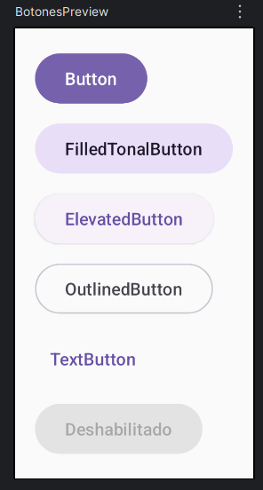

> [!TIP]
> Una pantalla debería tener **una sola** acción principal. Si todo es un `Button` relleno, no destaca nada.

### El contenido es una ranura

Fíjate en que `Button` **no tiene un parámetro `text`**. Su último parámetro es `content: @Composable RowScope.() -> Unit`: un hueco en el que puedes poner los composables que quieras, y que se colocan en fila. Por eso un botón con icono no necesita un componente especial:

```kotlin
Button(
    onClick = onEnviar,
    contentPadding = ButtonDefaults.ButtonWithIconContentPadding
) {
    Icon(
        painter = painterResource(R.drawable.ic_send),
        contentDescription = null, // El texto de al lado ya dice lo que hace
        modifier = Modifier.size(ButtonDefaults.IconSize)
    )
    Spacer(Modifier.size(ButtonDefaults.IconSpacing))
    Text(stringResource(R.string.enviar))
}
```

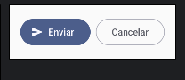

A este patrón se le llama **API de ranuras** (*slot API*) y lo vas a ver por todas partes en Compose: `Scaffold(topBar = { ... })`, `TopAppBar(title = { ... })`, `Card { ... }`, `AlertDialog(confirmButton = { ... })`... **Si un parámetro es de tipo `@Composable () -> Unit`, es una ranura**: el componente pone el marco y tú decides qué va dentro.

Para cambiar el aspecto están `shape` (por ejemplo `RoundedCornerShape(8.dp)`) y `colors = ButtonDefaults.buttonColors(containerColor = ..., contentColor = ...)`. Úsalos con moderación: si cambias el tema, los botones se adaptan solos; si les pones colores fijos, no.

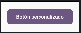

> [!NOTE]
> Los iconos de este tema se usan con `painterResource(R.drawable.ic_...)`: es la [opción 1 recomendada de T03](T03.md#opción-1-recomendada-importar-el-icono-como-vector-asset), importarlos como *Vector Asset*. Si copias código de Internet con `Icons.Filled.Xxx`, no compilará salvo que hayas añadido la librería de iconos.

### Botones de icono

`IconButton` es un botón que solo contiene un icono, sin fondo. Es el que se usa en las barras superiores y en los elementos de una lista (ya salió en el `WellnessTaskItem` de T04):

```kotlin
IconButton(onClick = onBorrar) {
    Icon(
        painter = painterResource(R.drawable.ic_delete),
        contentDescription = stringResource(R.string.borrar) // Obligatorio: no hay texto
    )
}
```

Aquí `contentDescription` **no puede ser `null`**: es lo único que lee TalkBack para decir qué hace el botón.

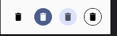

Tiene variantes con fondo (`FilledIconButton`, `FilledTonalIconButton`, `OutlinedIconButton`) y una que alterna entre dos estados, `IconToggleButton`, que sigue exactamente el patrón `checked` / `onCheckedChange` del `Switch`:

```kotlin
IconToggleButton(checked = esFavorito, onCheckedChange = onFavoritoChange) {
    Icon(
        painter = painterResource(if (esFavorito) R.drawable.ic_favorite else R.drawable.ic_favorite_border),
        contentDescription = stringResource(R.string.favorito)
    )
}
```

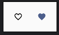

### Floating Action Button (FAB)

El FAB es el botón flotante que destaca **la** acción principal de una pantalla (crear un mensaje, añadir una tarea...). Se coloca en la ranura `floatingActionButton` del `Scaffold` (ver [Scaffold y TopAppBar](#6-scaffold-y-topappbar)).


| Composable | Para qué |
| :--- | :--- |
| `FloatingActionButton` | El normal |
| `SmallFloatingActionButton` / `LargeFloatingActionButton` | Lo mismo, más pequeño o más grande |
| `ExtendedFloatingActionButton` | Con icono **y** texto. Su parámetro `expanded` permite plegarlo a solo icono, por ejemplo al hacer scroll |

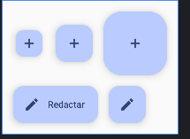

```kotlin
ExtendedFloatingActionButton(
    onClick = onNuevo,
    icon = { Icon(painterResource(R.drawable.ic_add), contentDescription = null) },
    text = { Text(stringResource(R.string.nuevo)) }
)
```

Guía de uso en Material: [FAB](https://m3.material.io/components/floating-action-button/overview).

-----

## 2. Menú desplegable


En Jetpack Compose con Material 3, para crear un menú desplegable asociado a un campo de texto (similar a un `Spinner` tradicional o un `<select>` en HTML), se utiliza el componente `ExposedDropdownMenuBox`. Este composable envuelve un `TextField` (generalmente no editable) y el menú desplegable (`ExposedDropdownMenu`) que aparece al interactuar con él. Los ítems individuales del menú se definen con `DropdownMenuItem`.

Aunque existe un `DropdownMenu` más genérico, `ExposedDropdownMenuBox` es el componente específico y recomendado cuando necesitas un selector desplegable vinculado visualmente a un campo de texto.

Para facilitar su reutilización, podemos encapsular esta lógica en una función composable personalizada. A continuación, se muestra un ejemplo de cómo crear un `DynamicSelectTextField` reutilizable:

> [!TIP]
> Como se dijo en la [Introducción](#introducción), quédate con su **contrato**: recibe el valor seleccionado y **eleva el evento** de cambio mediante una lambda.

```kotlin
@OptIn(ExperimentalMaterial3Api::class)
@Composable
fun DynamicSelectTextField(
    selectedValue: String,
    options: List<String>,
    label: String,
    onValueChangedEvent: (String) -> Unit,
    modifier: Modifier = Modifier
) {
    var expanded by remember { mutableStateOf(false) }

    ExposedDropdownMenuBox(
        expanded = expanded,
        onExpandedChange = { expanded = it }, // El componente ya nos da el valor nuevo
        modifier = modifier
    ) {
        OutlinedTextField(
            value = selectedValue,
            onValueChange = {}, // Vacío porque es readOnly
            readOnly = true,    // El campo de texto no se edita directamente
            label = { Text(label) },
            trailingIcon = {
                // Icono que indica si el menú está desplegado o no
                ExposedDropdownMenuDefaults.TrailingIcon(expanded = expanded)
            },
            modifier = Modifier
                .menuAnchor(ExposedDropdownMenuAnchorType.PrimaryNotEditable) // Ancla el menú al campo
                .fillMaxWidth()
        )
        // El menú desplegable en sí
        ExposedDropdownMenu(
            expanded = expanded,
            onDismissRequest = { expanded = false } // Al pulsar fuera, se cierra
        ) {
            // Un item del menú por cada opción
            options.forEach { option ->
                DropdownMenuItem(
                    text = { Text(option) },
                    onClick = {
                        onValueChangedEvent(option) // Avisa de la opción elegida
                        expanded = false            // Cierra el menú
                    },
                    contentPadding = ExposedDropdownMenuDefaults.ItemContentPadding
                )
            }
        }
    }
}
```

**Parámetros de `DynamicSelectTextField`:**

- `selectedValue`: El valor (String) actualmente seleccionado, que se muestra en el `TextField`.
- `options`: Una lista de Strings (`List<String>`) que representan las opciones disponibles en el desplegable.
- `label`: La etiqueta (String) que se muestra en el `OutlinedTextField`.
- `onValueChangedEvent`: Una función lambda `(String) -> Unit` que se invoca cuando el usuario selecciona una nueva opción. Recibe la opción seleccionada como parámetro.
- `modifier`: Un `Modifier` opcional para personalizar la apariencia o disposición del componente.

Dos detalles del código:

- `ExposedDropdownMenuAnchorType.PrimaryNotEditable` le dice al menú que el campo **no** se puede escribir. Existe también `PrimaryEditable`, que toma el foco y abre el teclado: es el que se usa en un desplegable con filtro de búsqueda, no en un selector cerrado como este.
- `onExpandedChange = { expanded = it }`: el componente ya te dice si se tiene que abrir o cerrar. Si lo inviertes tú (`expanded = !expanded`), se desincroniza en cuanto el evento llegue dos veces.

> [!NOTE]
> **Este componente sí tiene estado dentro (`expanded`), y está bien que sea así.** Si el menú está abierto o cerrado no le importa a nadie fuera del componente; lo que sí se eleva es la opción seleccionada. Es lo que vimos en [T04 · Composables con y sin estado](T04.md#6-composables-con-y-sin-estado): el objetivo es el **mínimo** estado posible dentro, no ningún estado.

**Ejemplo de uso:**

```kotlin
@Composable
@Preview(showBackground = true)
fun EjemploDropdownMenu() {
    val options = listOf("Manzana", "Plátano", "Fresa", "Naranja")
    // Estado para guardar la selección actual
    val (seleccion, setSeleccion) = remember { mutableStateOf(options[0]) } // Opción por defecto

    Column(modifier = Modifier.padding(16.dp)) {
        DynamicSelectTextField(
            selectedValue = seleccion,
            options = options,
            label = "Fruta favorita",
            onValueChangedEvent = setSeleccion // Actualiza el estado al seleccionar
        )
        Spacer(modifier = Modifier.height(16.dp))
        Text("Has seleccionado: $seleccion") // Muestra la selección actual
    }
}
```


Trucazo 🤙: Para mejorar la usabilidad, si la lista de `options` es muy larga, considera alternativas como un diálogo de selección con filtro de búsqueda o agrupar las opciones en submenús si la lógica lo permite. Esto evita que el usuario tenga que hacer un scroll excesivo.

## 3. RatingBar: un componente propio

Permite que el usuario de forma visual pueda valorar o ver la valoración de una entidad (película, música, artículo...). Material 3 **no tiene** un componente que lo represente, así que vamos a crear una función sencilla que nos permita manejarlo.

La función crea un `Row` con tantos `Icon` como estrellas. En función de la valoración actual, cada estrella se dibuja rellena o hueca.

Primero, importa los dos iconos como *Vector Asset*, igual que en [T03 · Iconos de contacto](T03.md#iconos-de-contacto-icon): en *Clip art*, busca `star` y `star border`, y guárdalos como `ic_star` e `ic_star_border`.

La función quedaría como sigue:

```kotlin
/**
 * Barra de valoración con estrellas.
 * @param rating valoración actual, de 0 a [maxRating]
 * @param onRatingChange se llama con la nueva valoración al pulsar una estrella
 * @param maxRating número de estrellas
 * @param starSize tamaño de cada estrella
 * @param color color de las estrellas
 */
@Composable
fun RatingBar(
    rating: Int,
    onRatingChange: (Int) -> Unit,
    modifier: Modifier = Modifier,
    maxRating: Int = 5,
    starSize: Dp = 40.dp,
    color: Color = MaterialTheme.colorScheme.primary
) {
    Row(modifier = modifier.selectableGroup()) {
        for (i in 1..maxRating) {
            Icon(
                painter = painterResource(
                    if (i <= rating) R.drawable.ic_star else R.drawable.ic_star_border
                ),
                contentDescription = "$i / $maxRating",
                tint = color,
                modifier = Modifier
                    .size(starSize)
                    .selectable(
                        selected = i == rating,
                        // Pulsar la primera estrella cuando ya está sola deja la valoración a 0
                        onClick = { onRatingChange(if (i == 1 && rating == 1) 0 else i) },
                        role = Role.RadioButton
                    )
            )
        }
    }
}
```

- `selectableGroup` + `selectable` + `Role.RadioButton` es lo mismo que usamos en el [RadioButton de T04](T04.md#radiobutton): las estrellas se comportan como un grupo de opciones del que solo se elige una, y TalkBack lo anuncia así.
- El `modifier` del parámetro va a la `Row`; cada estrella tiene su propio tamaño (`starSize`). Si le pusieras `Modifier.size(40.dp)` a la `Row`, las cinco estrellas tendrían que caber en 40dp.
- El orden de los parámetros es el habitual en Compose: primero los obligatorios, después `modifier` y al final los opcionales.

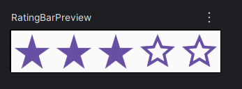

Un ejemplo de su uso sería el siguiente:

Ejemplo 1 con desestructuración del par de estado de `mutableIntStateOf`:

```kotlin
@Composable
@Preview(showBackground = true)
fun RatingBarPreview() {
    val (rating, setRating) = remember { mutableIntStateOf(3) }
    Box(
        modifier = Modifier.fillMaxSize(),
        contentAlignment = Alignment.Center
    ) {
        RatingBar(
            rating = rating,
            onRatingChange = setRating
        )
    }
}
```

Ejemplo 2 con delegación del estado a través de `by`:

```kotlin
@Composable
@Preview(showBackground = true)
fun RatingBarPreviewAlt() {
    var rating by remember { mutableIntStateOf(2) }
    Box(
        modifier = Modifier.fillMaxSize(),
        contentAlignment = Alignment.Center
    ) {
        RatingBar(
            rating = rating,
            onRatingChange = { rating = it },
            starSize = 32.dp,
            color = Color(0xFFFFC107) // Si además la quiero de otro color
        )
    }
}
```

> [!TIP]
> **Recuerda** las [tres formas de declarar un estado](T04.md#3-guardar-el-estado-con-mutablestateof-y-remember) de T04. Con desestructuración puedes pasar el setter tal cual (`onRatingChange = setRating`), pero si el evento tiene que hacer algo más, como mostrar un `Toast`, hay que envolverlo en una lambda. En ese caso `by` queda más claro:
>
> ```kotlin
> var rating by remember { mutableIntStateOf(3) }
>
> RatingBar(
>     rating = rating,
>     onRatingChange = {
>         rating = it                                                          // 1. Cambia el estado
>         Toast.makeText(context, "$it estrellas", Toast.LENGTH_SHORT).show() // 2. Lógica extra
>     }
> )
> ```

> [!NOTE]
> En el tema de los iconos hay una transición hacia [Material Symbols](https://fonts.google.com/icons?icon.set=Material+Symbols), la evolución de Material Icons. Los iconos que ofrece el *Clip art* del Vector Asset ya salen de ahí, así que importándolos de esta forma los estás usando sin tocar Gradle.

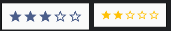

-----

## 4. Card

Una `Card` es un contenedor con fondo, esquinas redondeadas y, opcionalmente, sombra, que agrupa información sobre **una sola cosa**: un producto, un contacto, un juego. Su contenido es una ranura que se coloca en columna (`ColumnScope`):

```kotlin
@Composable
fun IngredienteCard(
    @DrawableRes imagen: Int,
    @StringRes nombre: Int,
    modifier: Modifier = Modifier
) {
    Card(modifier = modifier.width(120.dp)) {
        Image(
            painter = painterResource(imagen),
            contentDescription = null,
            contentScale = ContentScale.Crop,
            modifier = Modifier
                .fillMaxWidth()
                .aspectRatio(1f)
        )
        Text(
            text = stringResource(nombre),
            style = MaterialTheme.typography.titleSmall,
            modifier = Modifier.padding(8.dp)
        )
    }
}
```

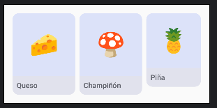

Hay tres variantes: `Card` (relleno suave), `ElevatedCard` (con sombra) y `OutlinedCard` (con borde). Si la tarjeta entera se puede pulsar, usa la versión que recibe `onClick`, en lugar de añadir `Modifier.clickable`: así la animación del pulso y la accesibilidad vienen de serie.

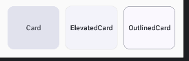

```kotlin
Card(onClick = { onSeleccionar(juego) }) { /* ... */ }
```

La volverás a ver en T06: cada elemento de una lista suele ser una `Card`.

## 5. Diálogos

En el sistema de vistas, un diálogo se creaba y se mostraba con `show()`. En Compose no: **el diálogo está en pantalla mientras su composable forma parte de la composición**, igual que el `Text` condicional del contador de [T04 · UI dirigida por el estado](T04.md#4-ui-dirigida-por-el-estado). Lo controlas con un estado:

```kotlin
var mostrarDialogo by remember { mutableStateOf(false) }

Button(onClick = { mostrarDialogo = true }) {
    Text("Vaciar pedido")
}

if (mostrarDialogo) {
    AlertDialog(
        onDismissRequest = { mostrarDialogo = false },
        title = { Text("¿Vaciar el pedido?") },
        text = { Text("Se quitarán todos los ingredientes.") },
        confirmButton = {
            TextButton(onClick = {
                onVaciar()
                mostrarDialogo = false
            }) { Text("Vaciar") }
        },
        dismissButton = {
            TextButton(onClick = { mostrarDialogo = false }) { Text("Cancelar") }
        }
    )
}
```

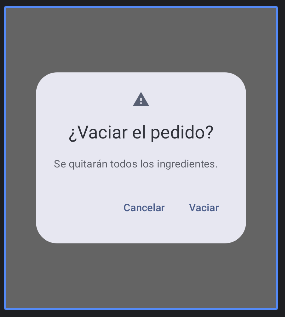

- `onDismissRequest` se llama cuando el usuario pulsa fuera del diálogo o el botón Atrás. Si no pones el estado a `false`, el diálogo no se cierra.
- Los botones del diálogo son `TextButton`: es el énfasis que recomienda Material para los diálogos.
- `title`, `text`, `icon`, `confirmButton` y `dismissButton` son ranuras, como las del `Button`.

## 6. Scaffold y TopAppBar

En Material Design, un `Scaffold` es la estructura básica de una pantalla: une las barras de la app, el botón flotante y el contenido, y se encarga de colocarlos sin que se pisen.


Cuando creamos un nuevo proyecto, la `Activity` ya está montada sobre un `Scaffold`, como vimos en [T03 · Qué hay en MainActivity](T03.md#qué-hay-en-mainactivity). Sus parámetros son **ranuras**, igual que las del `Button`:

| Ranura | Qué va dentro |
| :--- | :--- |
| `topBar` | La barra superior, normalmente una `TopAppBar` |
| `bottomBar` | La barra inferior (navegación, acciones) |
| `floatingActionButton` | El [FAB](#floating-action-button-fab) |
| `snackbarHost` | Dónde se pintan los [Snackbar](#snackbar) |
| `content` | El contenido de la pantalla, el lambda final que recibe `innerPadding` |

**`innerPadding` no es opcional.** Con `enableEdgeToEdge()` la app se dibuja también detrás de la barra de estado y de la de navegación. El `Scaffold` calcula cuánto ocupan esas barras **y las suyas propias** (`topBar`, `bottomBar`) y te lo da en `innerPadding`. Si no lo aplicas, la `TopAppBar` tapa el principio del contenido:

```kotlin
Scaffold(
    topBar = { TopAppBar(title = { Text(stringResource(R.string.app_name)) }) }
) { innerPadding ->
    Contenido(modifier = Modifier.padding(innerPadding)) // Sin esto, la barra lo tapa
}
```

### TopAppBar

La barra superior también tiene sus ranuras:

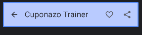

- `title`: el título de la pantalla.
- `navigationIcon`: el icono de la izquierda, normalmente la flecha de volver o el menú.
- `actions`: los `IconButton` de la derecha. Aquí es donde cobran sentido los [botones de icono](#botones-de-icono).

```kotlin
TopAppBar(
    title = { Text(stringResource(R.string.app_name)) },
    actions = {
        IconButton(onClick = onCompartir) {
            Icon(painterResource(R.drawable.ic_share), contentDescription = stringResource(R.string.compartir))
        }
    },
    colors = TopAppBarDefaults.topAppBarColors(
        containerColor = MaterialTheme.colorScheme.primaryContainer
    )
)
```

Tiene variantes que cambian la posición y el tamaño del título: `CenterAlignedTopAppBar`, `MediumTopAppBar` y `LargeTopAppBar`.

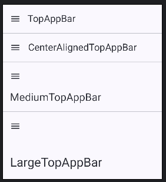

> [!NOTE]
> `TopAppBar` todavía está marcada como **experimental**, así que la función que la usa necesita `@OptIn(ExperimentalMaterial3Api::class)`. Significa que su API puede cambiar entre versiones de la librería; no es un error. Android Studio te lo propone con `Alt + Enter`.

-----

## 7. Mensajes al usuario: Toast y Snackbar

### Toast

Un `Toast` proporciona información simple sobre una acción en una pequeña ventana emergente que desaparece automáticamente.


```kotlin
Toast.makeText(context, "Pedido enviado", Toast.LENGTH_SHORT).show()
```

Un Toast es la respuesta a un **evento**, así que se lanza desde un callback (`onClick`, `onValueChange`...), nunca desde el cuerpo del composable:

```kotlin
@Composable
fun BotonPedido(modifier: Modifier = Modifier) {
    val context = LocalContext.current // Se lee fuera del lambda
    val mensaje = stringResource(R.string.pedido_enviado)

    Button(
        onClick = { Toast.makeText(context, mensaje, Toast.LENGTH_SHORT).show() },
        modifier = modifier
    ) {
        Text(stringResource(R.string.hacer_pedido))
    }
}
```

> [!WARNING]
> El cuerpo de un composable **describe** la UI, no **hace** cosas. Se ejecuta en cada recomposición ([T04 · Composición y recomposición](T04.md#2-composición-y-recomposición)): un Toast puesto ahí saldría al arrancar la app y cada vez que algo se recomponga. Mostrar un Toast, lanzar una petición o escribir en un fichero va en los callbacks de los eventos. Fíjate también en que `LocalContext.current` y `stringResource` son composables: se leen fuera del lambda y dentro se usa el valor. Si necesitas el texto dentro del lambda, usa `context.getString(R.string.xxx)`.

### Snackbar

El `Snackbar` es una barra inferior que sirve para mostrar un mensaje al usuario y, si quieres, ofrecerle una acción. Se pinta dentro de tu UI, en la ranura `snackbarHost` del `Scaffold`. Guía de diseño: [Snackbar en m3](https://m3.material.io/components/snackbar/overview).

Necesita tres piezas:

```kotlin
val snackbarHostState = remember { SnackbarHostState() } // 1. Quién controla los Snackbar
val scope = rememberCoroutineScope()                       // 2. Dónde lanzar la corrutina

Scaffold(
    snackbarHost = { SnackbarHost(snackbarHostState) },    // 3. Dónde se pintan
    floatingActionButton = {
        FloatingActionButton(onClick = {
            scope.launch { snackbarHostState.showSnackbar(mensaje) }
        }) {
            Icon(painterResource(R.drawable.ic_favorite), contentDescription = stringResource(R.string.mostrar_mensaje))
        }
    }
) { innerPadding -> /* ... */ }
```

`showSnackbar` es una función `suspend`: espera a que el Snackbar desaparezca (o a que el usuario pulse su acción) antes de devolver el control. Por eso hay que llamarla desde una corrutina, que lanzamos con el `scope` de `rememberCoroutineScope()`. Las corrutinas las veremos a fondo más adelante; de momento quédate con que `scope.launch { ... }` es la forma de llamar a una función `suspend` desde un evento.

**Snackbar con acción.** Es el uso más típico de verdad: avisar de algo y ofrecer deshacerlo. `showSnackbar` devuelve qué ha pasado:

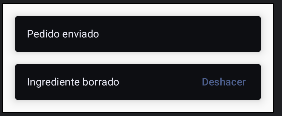

```kotlin
scope.launch {
    val resultado = snackbarHostState.showSnackbar(
        message = mensajeBorrado,
        actionLabel = textoDeshacer
    )
    if (resultado == SnackbarResult.ActionPerformed) {
        onDeshacer()
    }
}
```

### ¿Toast o Snackbar?

| | Toast | Snackbar |
| :--- | :--- | :--- |
| Quién lo pinta | El sistema, fuera de tu app | Tu UI, dentro del `Scaffold` |
| Estilo | El del sistema | Material 3, sigue tu tema |
| Puede llevar acción | No | Sí (*Deshacer*, *Reintentar*...) |
| Qué necesita | Un `Context` | `SnackbarHostState` + corrutina |
| Cuándo | Avisos rápidos, depuración | Lo recomendado para avisos dentro de la app |

## 8. Otros componentes

### Slider

El `Slider` es un control muy útil en aplicaciones móviles para la introducción de datos numéricos limitados por rangos:

```kotlin
@Composable
fun SliderConEtiqueta(
    etiqueta: String,
    valor: Float,
    onValorChange: (Float) -> Unit,
    modifier: Modifier = Modifier
) {
    Column(modifier = modifier) {
        Text("$etiqueta: ${valor.toInt()}")
        Slider(
            value = valor,
            onValueChange = onValorChange,
            valueRange = 0f..255f
        )
    }
}
```

- `value` + `onValueChange`: otra vez el mismo patrón de elevación de estado.
- `valueRange` (por defecto `0f..1f`) y `steps`, que divide el recorrido en saltos discretos.
- `onValueChangeFinished`: se llama al soltar el dedo. Sirve para no lanzar una operación cara en cada píxel del arrastre.

Documentación oficial: [Slider](https://developer.android.com/develop/ui/compose/components/slider).

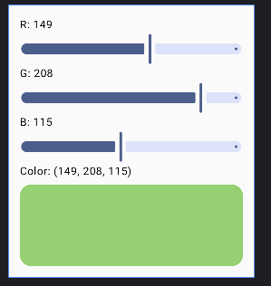

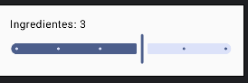

### Chips

Los chips son elementos compactos, con forma de pastilla, que representan una opción, un filtro o una acción. Hay cuatro tipos:

| Composable | Para qué |
| :--- | :--- |
| `AssistChip` | Una acción relacionada con el contenido: *Añadir al calendario*, *Cómo llegar* |
| `FilterChip` | Activar o desactivar un filtro u opción. Tiene estado `selected` |
| `InputChip` | Algo que ha introducido el usuario y se puede quitar: un destinatario, una etiqueta |
| `SuggestionChip` | Una sugerencia que se puede pulsar: respuestas rápidas, búsquedas |

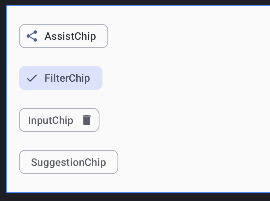

El que más vas a usar es `FilterChip`: es la alternativa moderna al `Checkbox` para filtros y opciones sueltas. Sigue el mismo patrón de estado:

```kotlin
FilterChip(
    selected = conQueso,
    onClick = { onQuesoChange(!conQueso) },
    label = { Text(stringResource(R.string.queso)) },
    leadingIcon = if (conQueso) {
        {
            Icon(
                painter = painterResource(R.drawable.ic_check),
                contentDescription = null,
                modifier = Modifier.size(FilterChipDefaults.IconSize)
            )
        }
    } else null
)
```

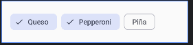

`leadingIcon` es una ranura opcional: si el chip está seleccionado le pasamos un lambda con la marca, y si no, `null` para que no haya icono.

### Indicadores de progreso

Los vas a necesitar en cuanto haya consumo de APIs (red) y son muy poco texto:

- `CircularProgressIndicator()` y `LinearProgressIndicator()` **sin parámetros**: indeterminados, para cuando no sabes cuánto falta.
- Con progreso: `LinearProgressIndicator(progress = { descargado / total })`. El progreso es un lambda y no un `Float`; de momento basta con saber que se escribe así.
- El patrón típico: `if (cargando) CircularProgressIndicator() else Contenido()`. Otra vez UI dirigida por el estado.

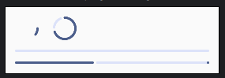

## 9. Errores frecuentes

- `onClick = hacerAlgo()` en lugar de `onClick = { hacerAlgo() }`: no compila, porque le estás pasando lo que devuelve la función y no la función.
- `onClick = { hacerAlgo }` sin paréntesis: compila, pero no hace nada (solo nombra la función, no la llama).
- `IconButton` con `contentDescription = null`.
- Mostrar un Toast o llamar a `showSnackbar` en el cuerpo del composable.
- Llamar a `stringResource` o `LocalContext.current` dentro de un `onClick`.
- No aplicar el `innerPadding` del `Scaffold`.
- Elevar el estado `expanded` del desplegable "por si acaso".
- Copiar código con `Icons.Xxx` sin tener la librería ([T03](T03.md#iconos-de-contacto-icon)).

-----

## Ejercicio: una app con todos los componentes

Vas a construir una sola app en un solo proyecto, por fases. Cada fase obligatoria termina con un **tag** de git que marca esa versión:

| Fase | Qué haces | Tag |
| :--- | :--- | :--- |
| [1](#fase-1-pedido-de-pizza) | Pantalla de pedido de pizza | `v1.0` |
| [2](#fase-2-selector-de-color) | Pantalla de selector de color | `v2.0` |
| [3](#fase-3-una-app-que-lo-une-todo) | Una app con `Scaffold` que permite elegir entre las dos pantallas | `v3.0` |
| [Extra](#fase-extra-opcional-valoración) | Valoración de la pizza, como tercera pantalla (opcional) | — |

### Preparación del proyecto

1. Crea un nuevo proyecto **Empty Activity** (Compose) llamado `T05Ejercicios`. Este lo vamos a usar a lo largo de todas las fases. Indica como `Package name` tu nombre, como muestra la imagen:

    

2. Activa el control de versiones (`VCS > Enable Version Control Integration...`) o `git init` en la terminal.
3. Haz el primer commit: `git add .` y `git commit -m "first commit"` o un mensaje similar.
4. Crea un repositorio **privado** llamado `T05Ejercicios` en tu organización de GitHub y sube el proyecto. Con GitHub CLI, desde la carpeta del proyecto, es un solo comando, como en [T03](T03.md#cómo-entregarlo):

    ```bash
    gh repo create ORG_NAME/T05Ejercicios --private --source=. --remote=origin --push
    ```

5. Durante todo el ejercicio, haz suficientes commits para que se vea la evolución en el tiempo.

> [!NOTE]
> Para crear un tag y subirlo al repositorio remoto (hace falta el segundo comando: `git push` normal no sube los tags):
>
> ```bash
> git tag v1.0
> git push origin v1.0
> ```

-----

### Fase 1: pedido de pizza

> [!IMPORTANT]
> **Antes de empezar:** [T04 · Checkbox](T04.md#checkbox), [§1 Botones](#1-botones) y [§5 Diálogos](#5-diálogos).

1. Crea un nuevo fichero de Kotlin llamado `T05Fase1.kt`.

    <!-- IMAGEN: rehacer con el fichero T05Fase1.kt -->
    

2. Crea las funciones composables para una pantalla de un pedido de pizza en la que:
    - El pedido base vale **10 €**.
    - Se pueden añadir ingredientes a **2 €** cada uno. Pon al menos 3 ingredientes, los que tú prefieras; intenta ser original.
    - Se muestra el total según los ingredientes seleccionados.
    - Se muestran las imágenes de los ingredientes seleccionados.

    

3. (Opcional) Añade dos botones debajo del total:
    - Un `OutlinedButton` **"Vaciar"** que desmarca todos los ingredientes. Solo está habilitado (`enabled`) si hay algún ingrediente marcado.
    - Un `Button` con icono **"Hacer pedido"** que abre un `AlertDialog` con el resumen: los ingredientes elegidos y el total. Si se confirma, muestra un Toast "Pedido enviado" y vacía la selección; si se cancela, no pasa nada.

    <!-- IMAGEN: rehacer pizza_app.png y ejercicio01_ui_anotada.png con los botones y el diálogo -->

#### Especificaciones

- La UI deberá cumplir con las indicaciones mostradas en la siguiente imagen:

    

- Busca unas imágenes en Internet para los ingredientes e impórtalas a tu proyecto en la carpeta `drawable`.
- Las imágenes se mostrarán centradas respecto al espacio que le quede de pantalla. Para ello, el `Row` donde irán las imágenes debe ocupar todo el espacio y centrar su contenido.
- Todo el texto que se muestre al usuario tiene que ir en `strings.xml`, por ejemplo: `label = stringResource(R.string.queso)`.
- El código tiene que estar mínimamente documentado.
- Puedes añadir las mejoras visuales que desees. Por ejemplo, poner una imagen de una pizza de fondo de los ingredientes principales (acuérdate de `Box`).
- *Mejora opcional:* usa [`FilterChip`](#chips) en lugar de `Checkbox` para los ingredientes.
- Puedes probar la función en la `Activity` principal.

**Al terminar:** haz un commit "fin fase 1" y crea el tag **`v1.0`**.

-----

### Fase 2: selector de color

> [!IMPORTANT]
> **Antes de empezar:** [§8 Slider](#slider), [§1 Botones](#1-botones) y [T04 · rememberSaveable](T04.md#5-sobrevivir-a-la-rotación-con-remembersaveable).

1. Crea un nuevo fichero de Kotlin llamado `T05Fase2.kt`.
2. Crea las funciones composables para una pantalla que permita elegir un color al usuario utilizando sliders. Cada fila (letra + slider) es una función propia sin estado: puedes partir del `SliderConEtiqueta` de la [sección 8](#slider).

    

    El `Slider` devuelve valores `Float`, y la clase `Color` tiene un constructor con `Float` (de `0f` a `1f`) y otro con `Int` (de `0` a `255`). Si tus sliders van de `0f` a `255f`, convierte con `toInt()` y usa los enteros:

    ```kotlin
    .background(Color(red.toInt(), green.toInt(), blue.toInt()))
    ```

    Si van de `0f` a `1f`, puedes pasar los `Float` directamente.

3. Averigua cómo crear las esquinas redondeadas.
4. (Opcional) Añade dos botones:
    - Un `FilledTonalButton` **"Aleatorio"** que pone un color al azar (`Random.nextInt(256)` para cada canal).
    - Un `TextButton` **"Reiniciar"** que vuelve al color inicial. Deshabilitado si ya está en el color inicial.
5. El color elegido tiene que sobrevivir a la rotación de la pantalla ([T04 · rememberSaveable](T04.md#5-sobrevivir-a-la-rotación-con-remembersaveable)).
6. Todo el texto, en `strings.xml`. Para *"Color: (149, 208, 115)"* usa un string con parámetros: `<string name="color_actual">Color: (%1$d, %2$d, %3$d)</string>` y `stringResource(R.string.color_actual, r, g, b)`.
7. *Mejora opcional:* muestra el código hexadecimal debajo del color: `"#%02X%02X%02X".format(r, g, b)`.
8. Cuando termines, haz un commit "fin fase 2" y crea el tag **`v2.0`**.

-----

### Fase 3: una app que lo une todo

> [!IMPORTANT]
> **Antes de empezar:** [§2 Menú desplegable](#2-menú-desplegable), [§6 Scaffold y TopAppBar](#6-scaffold-y-topappbar) y [§7 Mensajes al usuario](#7-mensajes-al-usuario-toast-y-snackbar).

El objetivo es poder elegir la **Pizza** o el **Color** desde una lista desplegable, con el nombre de la pantalla actual en la `TopAppBar` y un FAB que muestra un Snackbar.


1. Haz un commit "inicio fase 3".
2. Crea un fichero `T05App.kt` con una función composable `App()` que contenga el `Scaffold`, y llámala desde la `Activity`:

    ```kotlin
    class MainActivity : ComponentActivity() {
        override fun onCreate(savedInstanceState: Bundle?) {
            super.onCreate(savedInstanceState)
            enableEdgeToEdge()
            setContent {
                T05EjerciciosTheme {
                    App()
                }
            }
        }
    }

    @OptIn(ExperimentalMaterial3Api::class)
    @Composable
    fun App() {
        Scaffold(
            modifier = Modifier.fillMaxSize(),
            topBar = {
                TopAppBar(title = { Text(text = stringResource(R.string.app_name)) })
            }
        ) { innerPadding ->
            //...
        }
    }
    ```

3. Prueba que funciona.
4. Copia el `DynamicSelectTextField` de la [sección 2](#2-menú-desplegable) en un nuevo fichero.
5. Los elementos de la lista desplegable tienen que guardarse como un array de string en `strings.xml`:

    ```xml
    <string-array name="opciones">
        <item>Pizza</item>
        <item>Color</item>
    </string-array>
    ```

    Y recuperarlos en la función `App`: `val opciones = stringArrayResource(R.array.opciones).toList()`

6. El estado de la lista lo necesitamos para el título y el mensaje, por lo que se tiene que **elevar** hasta la función `App`. Usa `rememberSaveable`, para que al girar el móvil no vuelvas a la primera pantalla:

    ```kotlin
    fun App() {
        val opciones = stringArrayResource(R.array.opciones).toList()
        val (pantallaActual, setPantallaActual) = rememberSaveable { mutableStateOf(opciones[0]) }
        //...
    }
    ```

7. Muestra en la `TopAppBar` la pantalla actual.
8. Crea un composable llamado `Body` que muestre el contenido principal (la lista y la pantalla elegida) y llámalo desde el `Scaffold`:

    ```kotlin
    Scaffold(...) { innerPadding ->
        Body(opciones, pantallaActual, setPantallaActual, Modifier.padding(innerPadding))
    }
    ```

    `Body` mostrará la lista desplegable y, en función del elemento elegido, la pantalla de la Fase 1 o la de la Fase 2.

9. Al cambiar de pantalla, muestra un Toast "Has elegido …". Recuerda que va en el **callback** del desplegable, no en el cuerpo de `Body` ([§7](#toast)):

    ```kotlin
    @Composable
    fun Body(
        opciones: List<String>,
        pantallaActual: String,
        onPantallaChange: (String) -> Unit,
        modifier: Modifier = Modifier
    ) {
        val context = LocalContext.current
        Column(modifier = modifier) {
            DynamicSelectTextField(
                selectedValue = pantallaActual,
                options = opciones,
                label = stringResource(R.string.elige_pantalla),
                onValueChangedEvent = { opcion ->
                    onPantallaChange(opcion)
                    Toast.makeText(
                        context,
                        context.getString(R.string.has_elegido, opcion),
                        Toast.LENGTH_SHORT
                    ).show()
                }
            )
            // ... pantalla de la Fase 1 o de la Fase 2 según pantallaActual
        }
    }
    ```

    

10. Añade al `Scaffold` un `FloatingActionButton` que muestre un Snackbar con **tu nombre** y la pantalla actual. Sigue los pasos de [§7 Snackbar](#snackbar): `SnackbarHostState`, `rememberCoroutineScope()` y la ranura `snackbarHost`.
    - El icono del FAB, con un Vector Asset.
    - El mensaje sale de `strings.xml`. Tu nombre va en un string y el formato en otro, y como `stringResource` no se puede llamar dentro del `onClick`, el mensaje se prepara fuera:

    ```xml
    <string name="mi_nombre">Tu Nombre</string>
    <string name="mensaje_snackbar">%1$s: %2$s</string>
    ```

    ```kotlin
    val mensaje = stringResource(R.string.mensaje_snackbar, stringResource(R.string.mi_nombre), pantallaActual)
    // ...
    floatingActionButton = {
        FloatingActionButton(onClick = {
            scope.launch { snackbarHostState.showSnackbar(mensaje) }
        }) {
            Icon(painterResource(R.drawable.ic_favorite), contentDescription = stringResource(R.string.mostrar_mensaje))
        }
    }
    ```

    

11. *Mejora opcional:* usa un `ExtendedFloatingActionButton` con texto.
12. Prueba que funciona, haz un commit "fin fase 3" y crea el tag **`v3.0`**.

-----

### Fase extra (opcional): valoración

> [!IMPORTANT]
> **Antes de empezar:** [§3 RatingBar](#3-ratingbar-un-componente-propio), [§4 Card](#4-card) y [§7 Toast](#toast).

1. Añade un fichero de Kotlin llamado `T05Valoracion.kt` y copia en él el `RatingBar` de la [sección 3](#3-ratingbar-un-componente-propio), con sus dos Vector Assets.
2. Crea una pantalla para valorar la pizza con:
    - Una `Card` que contenga una imagen de la pizza, una pregunta (*"¿Qué te ha parecido?"*) y el `RatingBar`.
    - Debajo, un texto con la nota elegida (*"Tu valoración: 4 / 5"*), o *"Sin valorar"* si la valoración es 0. Usa un string con parámetros: `<string name="tu_valoracion">Tu valoración: %1$d / %2$d</string>` y `stringResource(R.string.tu_valoracion, rating, 5)`.
    - Un `Button` **"Enviar valoración"**, habilitado solo si la valoración es mayor que 0, que muestra un Toast de agradecimiento con la nota.
3. La valoración tiene que sobrevivir a la rotación de la pantalla.
4. Añádela como tercera opción del desplegable de la Fase 3.

<!-- IMAGEN: pantalla de valoración con la Card, cuatro estrellas marcadas y el botón Enviar valoración -->

-----

## Entrega 🚨

- Ordena y documenta el código.
- Entrega el enlace a GitHub del repositorio `T05Ejercicios`, con los tags `v1.0`, `v2.0` y `v3.0`.
- Recuerda que todo el texto tiene que estar en `strings.xml`.

<details>
<summary>¿Te has atascado? Solución de referencia</summary>

En [t05-ejercicios-2026-pmdm](https://github.com/scontreraslopez/t05-ejercicios-2026-pmdm) tienes una solución de referencia del ejercicio.

Lo importante es que **llegues tú a la solución**: es lo que vas a tener que hacer en el examen, sin internet y sin nadie que te lo dé hecho. Úsala solo puntualmente, para desatascarte en un paso concreto o para comparar cuando ya lo tengas funcionando, no para copiarla.

Ten en cuenta que es un trabajo **de máximos**: está más pulida y completa de lo que se espera de tu entrega. No hace falta que la tuya quede igual; basta con que cumpla lo que pide cada fase.

</details>
