# T08 · Navegación

## Índice

- [Introducción](#introducción)
  - [El proyecto de partida](#el-proyecto-de-partida)
- [1. Principios de navegación](#1-principios-de-navegación)
  - [Un destino de inicio fijo](#un-destino-de-inicio-fijo)
  - [La navegación es una pila](#la-navegación-es-una-pila)
  - [Atrás y Arriba](#atrás-y-arriba)
  - [Enlaces profundos](#enlaces-profundos)
- [2. Navigation 2 y Navigation 3](#2-navigation-2-y-navigation-3)
- [3. Dependencias](#3-dependencias)
- [4. Las piezas: claves, pila y NavDisplay](#4-las-piezas-claves-pila-y-navdisplay)
  - [Claves](#claves)
  - [La pila es tuya](#la-pila-es-tuya)
  - [NavDisplay y entryProvider](#navdisplay-y-entryprovider)
- [5. Navegar es modificar una lista](#5-navegar-es-modificar-una-lista)
  - [Pasar datos a un destino](#pasar-datos-a-un-destino)
  - [Las pantallas no conocen la pila](#las-pantallas-no-conocen-la-pila)
- [6. TopAppBar y botón Arriba](#6-topappbar-y-botón-arriba)
- [7. Sobrevivir al giro: rememberNavBackStack](#7-sobrevivir-al-giro-remembernavbackstack)
  - [El estado dentro de cada pantalla](#el-estado-dentro-de-cada-pantalla)
- [8. Navegación y ViewModel](#8-navegación-y-viewmodel)
  - [Un ViewModel para toda la app](#un-viewmodel-para-toda-la-app)
  - [Un ViewModel por pantalla](#un-viewmodel-por-pantalla)
- [9. Barra de navegación inferior](#9-barra-de-navegación-inferior)
- [10. Errores frecuentes](#10-errores-frecuentes)
- [11. Si te encuentras Navigation 2](#11-si-te-encuentras-navigation-2)
- [Entrega: Galaxy Tracker 🚨](#entrega-galaxy-tracker-)
  - [Comprobaciones](#comprobaciones)
  - [Mejoras opcionales](#mejoras-opcionales)
- [Para ampliar](#para-ampliar)
  - [Animaciones](#animaciones)
  - [Diálogos como destino](#diálogos-como-destino)
  - [Devolver un resultado](#devolver-un-resultado)
  - [Una pila por pestaña](#una-pila-por-pestaña)
  - [Pantallas grandes: escenas](#pantallas-grandes-escenas)
  - [Deep links](#deep-links)
  - [Más lecturas](#más-lecturas)

## Introducción

Hasta ahora todas nuestras apps tenían **una sola pantalla**. Las apps de verdad tienen muchas: una lista, el detalle de cada elemento, los ajustes, un formulario... **Navegar** es cómo el usuario se mueve entre ellas: entrar en una pantalla, volver atrás, saltar a otra sección.

En este tema vemos primero los **principios** que cualquier app Android debe respetar al navegar, da igual con qué lo programes. Después los aplicamos con **Navigation 3**, la biblioteca de navegación de Jetpack pensada desde cero para Compose.

Todos los ejemplos del tema usan la misma app, **Galaxy Tracker**, que irás montando tú a medida que avanzas: cada sección práctica termina con un **🛠️ Paso** que haces en tu proyecto antes de pasar a la siguiente. Al terminar, la app es lo que [entregas](#entrega-galaxy-tracker-). Es un mapa galáctico al estilo de Mass Effect para llevar la cuenta de los sistemas estelares que has explorado. Tiene tres pantallas:

- **Galaxias**: la lista de galaxias (Serpent Nebula, Arcturus Stream...). Es la que ves al abrir la app.
- **Sistemas**: al pulsar una galaxia se abren sus sistemas estelares, y cada uno se puede marcar como explorado.
- **Progreso**: cuánto llevas explorado de cada galaxia. Desde aquí también puedes pulsar una galaxia para abrir sus sistemas.

Galaxias y Progreso son las dos secciones principales y se cambia entre ellas con una barra inferior. Sistemas es una pantalla de detalle a la que se llega desde cualquiera de las dos.

> [!IMPORTANT]
> Los *codelabs* oficiales del curso *Android Basics with Compose* (Cupcake y Lunch Tray) siguen enseñando **Navigation 2**. Este tema **no** los sigue: aquí usamos Navigation 3. Si te encuentras código con `NavHost` y `navController`, mira la tabla de equivalencias de [Si te encuentras Navigation 2](#11-si-te-encuentras-navigation-2).

La referencia oficial es la guía [Navigation 3](https://developer.android.com/guide/navigation/navigation-3) de Android Developers, y el repositorio [nav3-recipes](https://github.com/android/nav3-recipes) tiene ejemplos completos que funcionan para casi cualquier caso.

### El proyecto de partida

Proyecto de partida: [mass-effect-navigation](https://github.com/scontreraslopez/mass-effect-navigation). Las pantallas, el modelo, los datos y los componentes ya están hechos. Lo tuyo es **conectarlo todo**: la pila, el `NavDisplay`, la barra superior, el ViewModel y la barra inferior.

El repositorio tiene dos ramas y una tag:

| | Qué es |
| :--- | :--- |
| Rama `starter` | El proyecto de partida. **Trabajas aquí** |
| Rama `main` | La solución, con un commit por cada paso del tema |
| Tag `starting-point` | El proyecto de partida tal y como se entregó, por si quieres empezar de nuevo |

| Fichero | Qué contiene |
| :--- | :--- |
| `model/Galaxy.kt`, `model/StarSystem.kt` | El modelo. Cada `StarSystem` sabe a qué galaxia pertenece (`galaxyId`) y si está explorado (`explored`) |
| `data/GalaxyData.kt` | Un `object` con cinco galaxias y sus sistemas, escritos a mano |
| `ui/screens/` | `GalaxyListScreen`, `SystemListScreen` y `ProgressScreen`, terminadas y **sin estado**, con sus `@Preview` |
| `ui/components/` | Las tarjetas, la barra de progreso, el botón de volver y el fondo de estrellas |
| `res/drawable/` | Los iconos `ic_arrow_back`, `ic_public` e `ic_donut_large` |
| `res/values/strings.xml` | Los textos de la app |
| `MassEffectNavigationApp.kt` | El fondo de estrellas y un `Scaffold` que muestra la lista de galaxias, sin navegación. Los `// TODO` te dicen qué va en cada sitio |

> [!IMPORTANT]
> **🛠️ Paso 1 · En tu app**
>
> 1. Clona la rama `starter` del proyecto de partida y súbela a un repositorio **privado** de tu organización, como hiciste con los *codelabs* de [T07](T07.md):
>
>    ```bash
>    git clone -b starter https://github.com/scontreraslopez/mass-effect-navigation T08-galaxy-tracker
>    cd T08-galaxy-tracker
>    git remote rename origin upstream
>    gh repo create YourMovilOrganization/T08-galaxy-tracker --private --source=. --remote=origin --push
>    ```
>
>    Con `-b starter` empiezas en la rama `starter`. Si clonas sin él, te quedas en `main`, que es la solución.
>
> 2. Ábrelo en Android Studio y ejecútalo: verás la lista de galaxias, y al pulsarlas no pasa nada.
>
> A partir de aquí, haz **un commit por paso**, para que se vea cómo crece la navegación.

> [!TIP]
> La solución queda en `upstream/main`, y puedes usarla para comprobar un paso cuando lo termines o si te atascas:
>
> ```bash
> git fetch upstream                                    # trae la última versión de la solución
> git log --oneline starting-point..upstream/main       # los pasos de la solución, un commit cada uno
> git show <commit>                                     # qué cambia en un paso concreto
> git diff HEAD upstream/main -- app/src/main/java      # tu código frente a la solución final
> ```
>
> Para repetir el ejercicio desde cero sin perder tu intento, crea una rama desde la tag: `git switch -c segundo-intento starting-point`.

## 1. Principios de navegación

Google define unos [principios de navegación](https://developer.android.com/guide/navigation/principles) para que todas las apps se comporten igual. Así, el usuario no tiene que aprender a moverse por cada app nueva. Son reglas de **diseño**: valen aunque no uses ninguna biblioteca de navegación.

### Un destino de inicio fijo

Cada pantalla a la que se puede navegar es un **destino**. Toda app tiene un **destino de inicio fijo**: la primera pantalla que ves al abrirla desde el lanzador y la última que ves antes de salir con el botón Atrás.

En Galaxy Tracker, el destino de inicio es la lista de galaxias.

> [!NOTE]
> Una pantalla de *login* o de bienvenida que solo aparece la primera vez **no** es el destino de inicio: solo la ves en ciertos casos. Es lo que Google llama navegación condicional.

### La navegación es una pila

El estado de la navegación se guarda en una **pila** de destinos, la *back stack*:

- En el fondo de la pila está siempre el destino de inicio.
- En la cima está la pantalla que ves.
- Lo que hay en medio es el historial: las pantallas a las que puedes volver.

Navegar a un destino lo **apila** encima (*push*). Volver atrás **desapila** el de la cima (*pop*) y se ve el anterior. Las operaciones siempre se hacen sobre la cima.

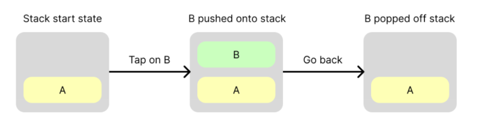

*Figura: [Android Developers](https://developer.android.com/guide/navigation/navigation-3/basics), [CC BY 4.0](https://creativecommons.org/licenses/by/4.0/deed.es).*

En Galaxy Tracker:

```text
Abres la app                       [Galaxias]
Pulsas Serpent Nebula              [Galaxias, Sistemas de Serpent Nebula]
Atrás                              [Galaxias]
Pulsas Progreso en la barra        [Galaxias, Progreso]
Pulsas Arcturus Stream             [Galaxias, Progreso, Sistemas de Arcturus Stream]
Atrás                              [Galaxias, Progreso]
Atrás                              [Galaxias]
Atrás                              Se cierra la app: Galaxias es el destino de inicio
```

### Atrás y Arriba

Hay dos botones para volver:

- **Atrás** (*Back*): el botón o el gesto de atrás del sistema, en la barra de navegación de Android.
- **Arriba** (*Up*): la flecha de la izquierda de la `TopAppBar` ([T05 · TopAppBar](T05.md#topappbar)).

Dentro de tu app, **los dos hacen lo mismo**: desapilar la cima. La diferencia es que **Arriba nunca te saca de la app**. En el destino de inicio no se muestra la flecha; Atrás, en cambio, sí está y cierra la app.

### Enlaces profundos

Un **enlace profundo** (*deep link*) abre la app directamente en un destino concreto, por ejemplo desde una notificación o desde un enlace web. El principio dice que el enlace debe **simular la navegación manual**. Si abres los sistemas de Serpent Nebula desde un enlace, la pila no es solo `[Sistemas de Serpent Nebula]`, sino `[Galaxias, Sistemas de Serpent Nebula]`, la misma que tendrías si hubieras llegado pulsando. Así, Arriba y Atrás te llevan por pantallas que tienen sentido.

No vamos a programar enlaces profundos en este tema (ver [Deep links](#deep-links) en la ampliación), pero conviene saber que existe la regla.

## 2. Navigation 2 y Navigation 3

Jetpack tiene dos bibliotecas de navegación:

- **Navigation 2** (`androidx.navigation`) nació en la época de los Fragments y luego se adaptó a Compose (*Navigation Compose*). La pila la gestiona un `NavController`, y tú le pides cosas: `navigate(...)`, `popBackStack()`.
- **Navigation 3** (`androidx.navigation3`) se escribió desde cero para Compose. Es estable desde noviembre de 2025. **La pila es tuya**: es una lista de Kotlin, y navegar es añadir y quitar elementos de esa lista.

Navigation 2 no está obsoleto y Google lo sigue manteniendo. De hecho, parte de su documentación sigue recomendándolo para Compose, porque no se ha actualizado toda a la vez. Aquí usamos Navigation 3 por tres motivos:

- **Es Compose de verdad.** La pila es estado observable, como el de [T04](T04.md#9-estado-en-listas). Cuando cambia, la UI se recompone. No hay que aprender un modelo nuevo.
- **Es más fácil de razonar.** No hay grafo ni opciones como `popUpTo` o `launchSingleTop`: si sabes manejar una lista, sabes navegar.
- **Es donde llegan las novedades**: pantallas grandes con varios paneles, gesto de atrás predictivo, resultados entre pantallas.

Los conceptos clave son los mismos en las dos. Cambia la forma de usarlos:

| Concepto | Qué es | En Navigation 3 |
| :--- | :--- | :--- |
| **Destino** | Una pantalla a la que se puede navegar | Un `NavEntry` |
| **Clave** (o ruta) | Identifica un destino y los datos que necesita | Un `data object` o una `data class` tuya |
| **Pila** | El historial de navegación | Una lista de claves |
| **Contenedor** | El composable que muestra el destino actual | `NavDisplay` |

## 3. Dependencias

> [!IMPORTANT]
> Navigation 3 necesita `compileSdk` 36 o superior y `minSdk` 23 o superior. Los proyectos nuevos de Android Studio ya cumplen las dos cosas; si tu proyecto es antiguo, comprueba `app/build.gradle.kts`.

Las dependencias de este tema van en cuatro bloques, cada uno para una cosa distinta:

1. **Navigation 3**: la navegación en sí.
2. **Serialización**: para que la pila sobreviva al giro.
3. **ViewModel**: las mismas de [T07](T07.md#el-patrón-completo-en-viewmodel-y-ui). Si ya las tienes, no las repitas.
4. **ViewModel + Navigation 3**: para que cada pantalla tenga su propio ViewModel.

En `gradle/libs.versions.toml`:

```toml
[versions]
# ...lo que ya hay (incluida lifecycleRuntimeKtx)...
nav3Core = "1.2.1"
kotlinxSerializationCore = "1.12.0"

[libraries]
# ...lo que ya hay...

# 1. Navigation 3
androidx-navigation3-runtime = { module = "androidx.navigation3:navigation3-runtime", version.ref = "nav3Core" }
androidx-navigation3-ui = { module = "androidx.navigation3:navigation3-ui", version.ref = "nav3Core" }

# 2. Serialización
kotlinx-serialization-core = { module = "org.jetbrains.kotlinx:kotlinx-serialization-core", version.ref = "kotlinxSerializationCore" }

# 3. ViewModel (de T07)
androidx-lifecycle-viewmodel-compose = { module = "androidx.lifecycle:lifecycle-viewmodel-compose", version.ref = "lifecycleRuntimeKtx" }
androidx-lifecycle-runtime-compose = { module = "androidx.lifecycle:lifecycle-runtime-compose", version.ref = "lifecycleRuntimeKtx" }

# 4. ViewModel + Navigation 3
androidx-lifecycle-viewmodel-navigation3 = { module = "androidx.lifecycle:lifecycle-viewmodel-navigation3", version.ref = "lifecycleRuntimeKtx" }

[plugins]
# ...lo que ya hay...
kotlin-serialization = { id = "org.jetbrains.kotlin.plugin.serialization", version.ref = "kotlin" }
```

En el `build.gradle.kts` **de la raíz del proyecto**, dentro de `plugins`, como los demás:

```kotlin
alias(libs.plugins.kotlin.serialization) apply false
```

Y en `app/build.gradle.kts`:

```kotlin
plugins {
    // ...lo que ya hay...
    alias(libs.plugins.kotlin.serialization)
}

dependencies {
    // ...lo que ya hay...

    // 1. Navigation 3
    implementation(libs.androidx.navigation3.runtime)
    implementation(libs.androidx.navigation3.ui)

    // 2. Serialización (además del plugin de arriba)
    implementation(libs.kotlinx.serialization.core)

    // 3. ViewModel (de T07)
    implementation(libs.androidx.lifecycle.viewmodel.compose)
    implementation(libs.androidx.lifecycle.runtime.compose)

    // 4. ViewModel + Navigation 3
    implementation(libs.androidx.lifecycle.viewmodel.navigation3)
}
```

Para qué sirve cada una:

| Bloque | Dependencia | Qué trae | ¿La necesito? |
| :--- | :--- | :--- | :--- |
| 1. Navigation 3 | `navigation3-runtime` | `NavKey`, `NavEntry`, `entryProvider`, `rememberNavBackStack` | Siempre |
| 1. Navigation 3 | `navigation3-ui` | `NavDisplay` | Siempre |
| 2. Serialización | Plugin `kotlin-serialization` + `kotlinx-serialization-core` | La anotación `@Serializable`, para que la pila sobreviva al giro ([sección 7](#7-sobrevivir-al-giro-remembernavbackstack)) | En cualquier app real |
| 3. ViewModel | `lifecycle-viewmodel-compose` | `viewModel()` dentro de un composable | Si usas ViewModel |
| 3. ViewModel | `lifecycle-runtime-compose` | `collectAsStateWithLifecycle()`, para leer un `StateFlow` | Si usas ViewModel |
| 4. ViewModel + Navigation 3 | `lifecycle-viewmodel-navigation3` | Un ViewModel propio para cada pantalla ([Un ViewModel por pantalla](#un-viewmodel-por-pantalla)) | Solo si cada pantalla tiene el suyo |

- La versión del plugin de serialización **tiene que ser la misma que la de Kotlin**. Por eso usa `version.ref = "kotlin"`, la misma clave que el plugin `kotlin-compose` de la plantilla. Si en tu fichero se llama de otra forma, usa esa.
- Los bloques 3 y 4 son librerías de lifecycle y reutilizan la versión `lifecycleRuntimeKtx` de la plantilla, como en T07. `lifecycle-viewmodel-navigation3` necesita la 2.10.0 o superior.
- Si ya tienes el bloque 3 de T07 en el `libs.versions.toml`, no lo copies otra vez: Gradle da error si una clave aparece dos veces.
- Con un único ViewModel para toda la app ([sección 8](#un-viewmodel-para-toda-la-app)) basta con el bloque 3. El bloque 4 solo hace falta si cada pantalla tiene su propio ViewModel.

Fuentes para comprobar las últimas versiones: [Navigation 3](https://developer.android.com/jetpack/androidx/releases/navigation3), [Lifecycle](https://developer.android.com/jetpack/androidx/releases/lifecycle) y la página [Get started](https://developer.android.com/guide/navigation/navigation-3/get-started) de la guía.

> [!IMPORTANT]
> **🛠️ Paso 2 · En tu app**
>
> 1. Añade los bloques 1, 2 y 3 al `libs.versions.toml`, y el plugin de serialización a los dos `build.gradle.kts`. El bloque 4 no lo necesitas: Galaxy Tracker usa un único ViewModel.
> 2. Pulsa **Sync Now** y espera a que termine sin errores.
> 3. Ejecuta la app: tiene que verse igual que antes. Si no compila, revisa que la versión del plugin de serialización sea la de Kotlin.
>
> Haz commit: `Paso 2: dependencias`.

## 4. Las piezas: claves, pila y NavDisplay

### Claves

Cada destino se identifica con una **clave**: un tipo de Kotlin. Si el destino no necesita datos, es un `data object`. Si los necesita, una `data class`:

```kotlin
data object GalaxyList                    // La lista de galaxias: el destino de inicio
data class SystemList(val galaxyId: Int)  // Los sistemas de una galaxia
data object Progress                      // El progreso de exploración
```

> [!NOTE]
> Acostúmbrate a crear un paquete `navigation` y poner ahí las claves. Así sabes que son para navegar, y no se mezclan con el modelo ni con la UI.

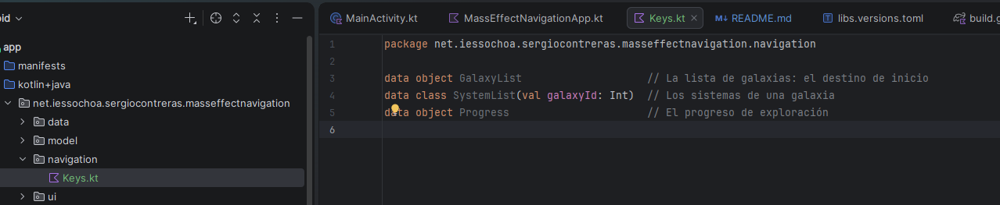

Una clave funciona como la **URL** de una web. La URL `/galaxia/1` no es la página en sí. Es una dirección que dice **qué** página mostrar (la de los sistemas de una galaxia) y **con qué datos** (los de la galaxia 1). La clave `SystemList(1)` dice exactamente lo mismo, solo que dentro de la app:

| | En una web | En la app |
| :--- | :--- | :--- |
| La dirección | `/galaxia/1` | La clave `SystemList(1)` |
| Lo que se ve | La página HTML | El composable `SystemListScreen` |

Por eso cada destino tiene dos nombres. `SystemList` es la clave, la dirección que se guarda en la pila. `SystemListScreen` es el composable que se pinta cuando esa clave llega a lo alto de la pila.

¿Por qué `data object` en unos casos y `data class` en otros?

- **`/progreso` siempre es la misma página**: no hay un progreso u otro. Basta con un `object`, una clase con **una única instancia**, como el `JuegoRepository` de [T06](T06.md#3-el-modelo-de-datos).
- **`/galaxia/1` y `/galaxia/2` son direcciones distintas** de la misma pantalla. Hace falta poder crear muchas, cada una con su dato: `SystemList(1)`, `SystemList(2)`... Eso es una `data class`.

El `data` de `data object` le da un `toString()` legible. Si imprimes la pila en Logcat, un `object` normal sale como `GalaxyList@1b6d3586`, y un `data object` como `GalaxyList`: verás `[GalaxyList, SystemList(galaxyId=1)]`. Además, Navigation 3 usa ese `toString()` por dentro para identificar cada pantalla de la pila. Por eso las claves sin datos son siempre `data object`.

### La pila es tuya

La pila es una **lista de claves**. Una lista observable, como las de [T04 · Estado en listas](T04.md#9-estado-en-listas):

```kotlin
val backStack = remember { mutableStateListOf<Any>(GalaxyList) } // Empieza con el destino de inicio
```

- Es de tipo `Any` porque las claves son de tipos distintos. En la [sección 7](#7-sobrevivir-al-giro-remembernavbackstack) la cambiaremos por una más tipada.
- Navegar es `backStack.add(...)`. Volver es `backStack.removeLastOrNull()`.

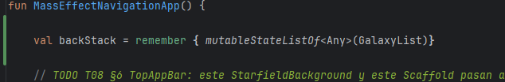

En Navigation 2 la pila estaba escondida dentro del `NavController`. Aquí la creas y la modificas tú, y por eso la puedes inspeccionar: `backStack.last()` es la pantalla actual, y `backStack.size` dice cuántas hay en el historial.

> [!NOTE]
> La pila se crea en el composable de entrada de la app, el que llama `MainActivity` (por convención lo llamamos `…App`). Ahí vive toda la lógica de navegación: las pantallas **no reciben la pila**, solo datos y lambdas. Lo verás en [Las pantallas no conocen la pila](#las-pantallas-no-conocen-la-pila).

### NavDisplay y entryProvider

`NavDisplay` es el composable que **observa la pila y muestra la cima**. Para saber qué pintar con cada clave, le das un `entryProvider`: una función que convierte cada clave en un destino (`NavEntry`) con su contenido.

En el proyecto, `MassEffectNavigationApp` ya tiene el fondo de estrellas y un `Scaffold` que muestra `GalaxyListScreen` directamente. El `NavDisplay` sustituye a esa llamada, dentro del `Scaffold` y con su `innerPadding`, igual que en [T05 · Scaffold](T05.md#6-scaffold-y-topappbar):

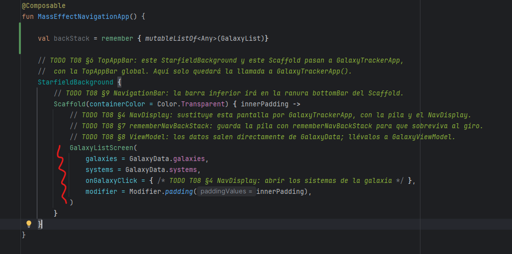

Ahí estamos llamando a la pantalla inicial directamente. Es hora de cambiarlo.

Primero añadimos el `NavDisplay`:

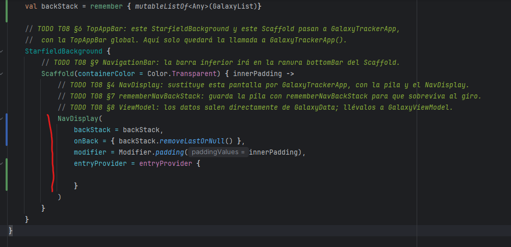

> [!WARNING]
> Cuidado con confundir `mutableStateListOf` con `mutableListOf`. La segunda no avisa a Compose cuando cambia, así que el `NavDisplay` no se recompone: añades una clave a la pila y la pantalla no cambia. De hecho, las dos capturas de arriba tienen esa errata.

Este bloque va a ser prácticamente siempre igual, porque funciona siempre de la misma manera:

- La pila del `NavDisplay` es la pila que hemos creado antes.
- Al pulsar Atrás, saca la cima de la pila.
- Recibe el `innerPadding` del `Scaffold`.
- Tiene un `entryProvider` con las pantallas a las que podremos navegar, de momento vacío.

Hasta aquí, la parte común. A continuación añadimos las entradas: un `entry` por cada **tipo** de clave, que dice "cuando la cima de la pila sea una clave de este tipo, pinta esta pantalla". `SystemList(1)` y `SystemList(2)` son claves distintas, pero las dos usan el mismo `entry<SystemList>` y, por tanto, la misma pantalla, cada una con sus datos.

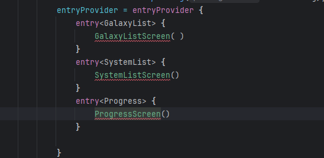

En este punto el compilador se queja, porque las pantallas necesitan los datos que van a pintar y las lambdas de sus eventos, que es donde irá la navegación.

Empezamos de arriba abajo. Al arrancar la app se ve la lista de galaxias, y lo que queremos es que al pulsar una galaxia (`onGalaxyClick`) se abran sus sistemas.

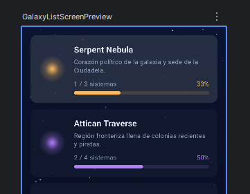

En esta ocasión la firma de la pantalla ya nos *chiva* que existe ese evento, pero es muy normal que no sea así y que tengas que añadirlo tú, como cualquier otra funcionalidad.

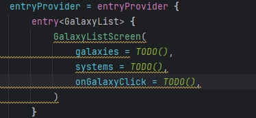

Los datos los sacamos de `GalaxyData`, nuestro repositorio. Para la navegación: al pulsar una galaxia tenemos que ir a `SystemListScreen`. Para eso habíamos preparado la clave `SystemList`, que guarda un valor, el id de la galaxia (de ahí que sea una `data class`). Con ese id, `SystemListScreen` podrá recuperar todo lo que necesita para pintar los sistemas de esa galaxia.

Así que al pulsar, apilamos `SystemList(it.id)`. Por claridad, renombramos `it` como `galaxy`:

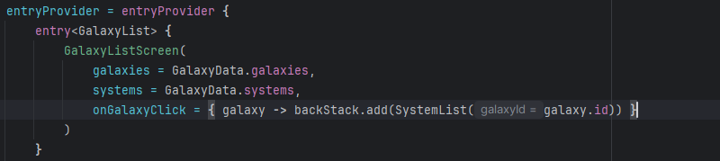

Ahora le decimos al `NavDisplay` qué hacer cuando la cima de la pila sea una clave de tipo `SystemList`. Repetimos la operación:

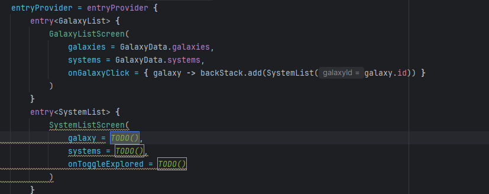

La galaxia la recuperamos del repositorio a partir de su id. Aquí pueden pasar dos cosas: que el repositorio ya tenga un método para eso (lo habitual) o que no lo tenga. Estamos en el segundo caso, así que la buscamos nosotros con `first`. Y aquí hay un pequeño problema: nos encontramos con dos lambdas, una dentro de la otra.

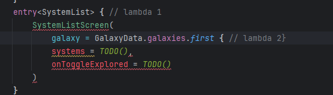

En estas circunstancias `it` se nos queda corto: dentro de la lambda 2, `it` es siempre el de la lambda más próxima (cada galaxia que recorre `first`), y no hay forma de llegar a la clave de la lambda 1. La solución es darle nombre al parámetro de la lambda exterior: `systemList`, `key` o algo del estilo. Con la recuperación de datos implementada queda como en la imagen. `onToggleExplored` todavía **no** lo implementamos: llegará en la [sección 8](#8-navegación-y-viewmodel).

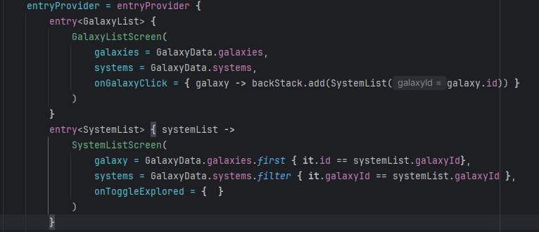

Si comentas temporalmente el `entry<Progress>`, ya puedes probar la app en este punto.

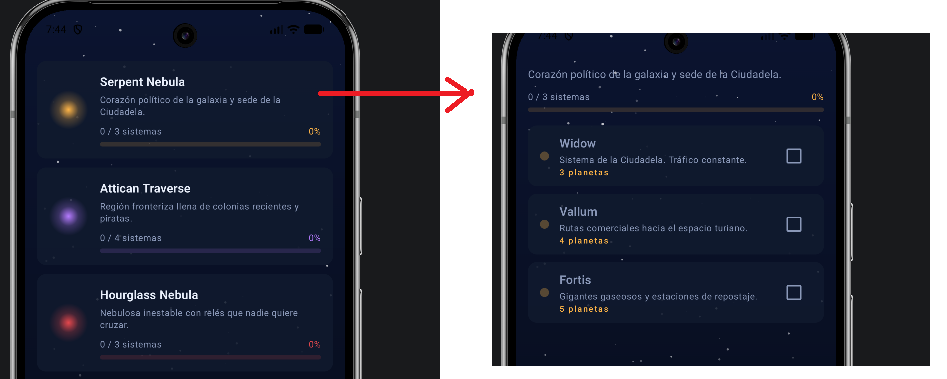

Todavía es un poco precario: no hay título, ni flecha para volver, ni nada de eso, pero ya vemos que funciona. Para volver atrás con esta implementación tenemos que usar el botón Atrás del propio teléfono. En el emulador está en la barra de herramientas de *Running Devices*:

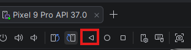

Vamos ahora con el último `entry`. Se rellena igual que el de `GalaxyList`, porque `ProgressScreen` recibe los mismos parámetros, aunque insistimos en que a esta pantalla todavía no se puede llegar: ya lo haremos. La única *dificultad* es darse cuenta de que, al pulsar una galaxia en Progreso, también se abren sus sistemas. Por eso `onGalaxyClick` hace exactamente lo mismo que en `GalaxyList`:

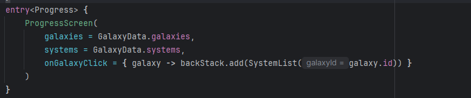

Así queda todo junto (aquí el parámetro de la lambda se llama `key`):

```kotlin
@Composable
fun MassEffectNavigationApp() {
    val backStack = remember { mutableStateListOf<Any>(GalaxyList) }

    StarfieldBackground {
        Scaffold(containerColor = Color.Transparent) { innerPadding ->
            NavDisplay(
                backStack = backStack,
                onBack = { backStack.removeLastOrNull() },
                modifier = Modifier.padding(innerPadding),
                entryProvider = entryProvider {
                    entry<GalaxyList> {
                        GalaxyListScreen(
                            galaxies = GalaxyData.galaxies,
                            systems = GalaxyData.systems,
                            onGalaxyClick = { galaxy -> backStack.add(SystemList(galaxy.id)) }
                        )
                    }
                    entry<SystemList> { key ->
                        SystemListScreen(
                            galaxy = GalaxyData.galaxies.first { it.id == key.galaxyId },
                            systems = GalaxyData.systems.filter { it.galaxyId == key.galaxyId },
                            onToggleExplored = { /* Lo haremos en la sección 8 */ }
                        )
                    }
                    entry<Progress> {
                        ProgressScreen(
                            galaxies = GalaxyData.galaxies,
                            systems = GalaxyData.systems,
                            onGalaxyClick = { galaxy -> backStack.add(SystemList(galaxy.id)) }
                        )
                    }
                }
            )
        }
    }
}
```

Recapitulando:

- **`backStack`**: la pila. Como es observable, cada vez que cambia `NavDisplay` se recompone y muestra la nueva cima.
- **`onBack`**: qué hacer cuando el usuario pulsa Atrás o hace el gesto. Lo normal es desapilar. Si no lo pones, hace justo eso, pero es mejor verlo escrito.
- **`entryProvider { }`**: dentro hay un `entry<Tipo> { }` por cada tipo de clave. El lambda recibe la clave (`key`), y de ella sacas los datos (`key.galaxyId`).
- `GalaxyListScreen`, `SystemListScreen` y `ProgressScreen` son composables normales, como cualquier pantalla que hayas hecho hasta ahora. De momento los datos salen directamente de `GalaxyData`, el repositorio de mentira del proyecto (como el `JuegoRepository` de [T06](T06.md#3-el-modelo-de-datos)).
- A `Progress` todavía no se puede llegar: lo haremos con la barra inferior de la [sección 9](#9-barra-de-navegación-inferior).

Los imports son `androidx.navigation3.ui.NavDisplay` y `androidx.navigation3.runtime.entryProvider`. Con el [auto import](T04.md#auto-import) aparecen solos.

`MainActivity` no cambia: sigue llamando a `MassEffectNavigationApp()` dentro del tema. La pila se crea fuera del `Scaffold` porque en la [sección 6](#6-topappbar-y-botón-arriba) la `TopAppBar` también la necesitará.

> [!NOTE]
> Fíjate en que no hay ninguna lista de "todas las pantallas de la app", ni un grafo que diga cuál va con cuál. Solo hay una pila y una función que sabe pintar cada clave. Así es Navigation 3.

> [!WARNING]
> **Un atajo de arquitectura.** Escribir `galaxies = GalaxyData.galaxies` dentro de un composable hace que la interfaz lea directamente de la capa de datos. Lo arreglaremos en el [Paso 7](#un-viewmodel-para-toda-la-app), cuando los datos pasen al ViewModel.
>
> Aun así, el atajo no desaparece del todo, porque `GalaxyViewModel` seguirá leyendo de `GalaxyData`, un `object` global. Un test no podría darle datos de prueba. Lo correcto es que el ViewModel **reciba el repositorio en el constructor** (inyección de dependencias), y para eso `viewModel()` necesita una *factory*. Lo verás en el tema de [Retrofit](T11.md), con datos que llegan de internet. Aquí no lo hacemos porque los datos son fijos y el tema va de navegación.

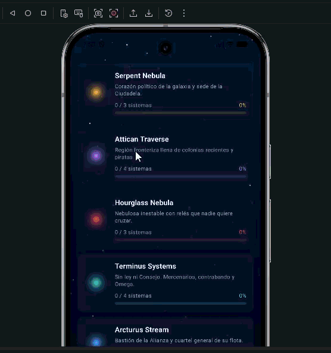

> [!IMPORTANT]
> **🛠️ Paso 3 · En tu app**
>
> 1. Crea un fichero `navigation/Keys.kt` con las tres claves. Todavía **sin** `@Serializable`: lo añadirás en el paso 6.
> 2. En `MassEffectNavigationApp`, crea la pila con `mutableStateListOf<Any>(GalaxyList)` y cambia la llamada a `GalaxyListScreen` por el `NavDisplay`, con un `entry` para cada clave.
> 3. Ejecuta: al pulsar una galaxia se abren sus sistemas, y Atrás vuelve a la lista. Marcar un sistema como explorado todavía no hace nada.
>
> Haz commit: `Paso 3: NavDisplay`.

## 5. Navegar es modificar una lista

Como la pila es una lista, cualquier navegación es una operación de lista:

| Quiero... | Código |
| :--- | :--- |
| Ir a un destino | `backStack.add(SystemList(1))` |
| Volver atrás | `backStack.removeLastOrNull()` |
| Volver al destino de inicio | `while (backStack.size > 1) backStack.removeLastOrNull()` |
| Sustituir la pantalla actual (que no se pueda volver a ella) | `backStack[backStack.lastIndex] = GalaxyList` |
| Saber en qué pantalla estoy | `backStack.last()` |

> [!WARNING]
> **La pila nunca puede quedarse vacía**: `NavDisplay` falla si no tiene nada que mostrar. Con el botón Atrás del sistema no pasa, porque cuando solo queda el destino de inicio es Android quien cierra la app. Pero si tú llamas a `removeLastOrNull()` sin comprobar nada, puedes vaciarla.

### Pasar datos a un destino

Los datos que necesita el destino van **en la clave**: `SystemList(galaxyId = 1)`. La pantalla los recibe en el lambda de `entry`.

**Pasa identificadores, no objetos.** Podrías meter en la clave la galaxia con su lista de sistemas, pero la clave es una foto del momento en que navegaste. Si después marcas un sistema como explorado, la copia de la clave no se entera y la pantalla sigue mostrando la lista vieja. Con el `galaxyId`, la pantalla busca los sistemas en los datos actuales (un repositorio o un ViewModel, [sección 8](#8-navegación-y-viewmodel)). Además, la clave tiene que poder guardarse al girar el móvil ([sección 7](#7-sobrevivir-al-giro-remembernavbackstack)), y cuanto más pequeña, mejor.

### Las pantallas no conocen la pila

Fíjate en la firma de `GalaxyListScreen`:

```kotlin
@Composable
fun GalaxyListScreen(
    galaxies: List<Galaxy>,
    systems: List<StarSystem>,
    onGalaxyClick: (Galaxy) -> Unit,
    modifier: Modifier = Modifier
)
```

La pantalla **no recibe la pila**. Avisa de que han pulsado una galaxia, y quien la usa decide qué hacer. Es la [elevación de estado de T04](T04.md#7-elevación-de-estado-state-hoisting), aplicada a la navegación: los eventos suben.

Así la pantalla se puede usar en una `@Preview` (con `onGalaxyClick = {}`) y no se rompe si mañana cambias cómo navegas. Fíjate también en que `ProgressScreen` usa el mismo evento, y en los dos casos el `entryProvider` hace lo mismo: apilar `SystemList`. **Toda la navegación se queda en un sitio**: el `entryProvider`.

> [!IMPORTANT]
> **🛠️ Paso 4 · En tu app**
>
> Vas a ver la pila por dentro con [Logcat](T04.md#comprobar-valores-con-logcat).
>
> 1. Escribe la pila en Logcat cada vez que cambia: después del `add` de `onGalaxyClick` y del `removeLastOrNull()` de `onBack`.
>
>    ```kotlin
>    onBack = {
>        backStack.removeLastOrNull()
>        Log.d("GalaxyTracker", "Pila: ${backStack.toList()}")
>    },
>    ```
>
> 2. Ejecuta, filtra por `tag:GalaxyTracker`, abre Serpent Nebula y vuelve. Tienes que ver `Pila: [GalaxyList, SystemList(galaxyId=1)]` y luego `Pila: [GalaxyList]`.
> 3. Quita el `data` de `data object GalaxyList`, repite y mira cómo sale ahora. Luego vuelve a ponerlo.
>
> Haz commit: `Paso 4: la pila en Logcat`. Los `Log.d` puedes dejarlos: te vendrán bien en los pasos siguientes.

## 6. TopAppBar y botón Arriba

El `Scaffold` de `MassEffectNavigationApp` ya envuelve el `NavDisplay`, así que una `TopAppBar` en su ranura `topBar` la comparten todas las pantallas. Su título y su botón Arriba dependen de la cima de la pila.

Empezamos con una función auxiliar que devuelva el título de cada pantalla. Los textos ya están en `strings.xml`:

- En la lista de galaxias, el nombre de la app: `<string name="app_name">Galaxy Tracker</string>`.
- En los sistemas: `<string name="systems_title">Sistemas</string>`.
- En el progreso: `<string name="progress_title">Progreso de exploración</string>`.

Lo que hay en la pila son claves, así que la función recibe la clave de la cima. `SystemList` es una `data class`: `SystemList(1)` y `SystemList(2)` son objetos distintos, así que se comprueba el tipo con `is`. `Progress` es un `object` con una única instancia, así que se compara directamente con él. Una posible implementación:

```kotlin
@StringRes
private fun titleFor(key: Any): Int = when (key) {
    is SystemList -> R.string.systems_title
    Progress -> R.string.progress_title
    else -> R.string.app_name
}
```

Con ella, el título de la `TopAppBar` es el que corresponde a la clave de la cima de la pila:

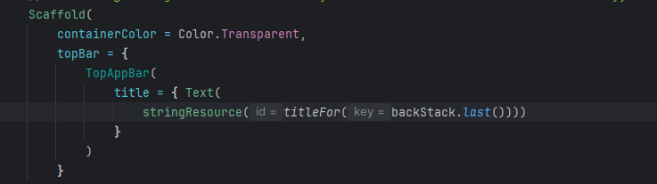

Falta el botón Arriba, que solo se muestra cuando hay algo debajo de la cima. Todo junto:

```kotlin
@OptIn(ExperimentalMaterial3Api::class)
@Composable
fun MassEffectNavigationApp() {
    val backStack = remember { mutableStateListOf<Any>(GalaxyList) }

    StarfieldBackground {
        Scaffold(
            containerColor = Color.Transparent,
            topBar = {
                TopAppBar(
                    title = { Text(stringResource(titleFor(backStack.last()))) },
                    navigationIcon = {
                        if (backStack.size > 1) { // Arriba nunca saca de la app
                            BackButton(onClick = { backStack.removeLastOrNull() })
                        }
                    }
                )
            }
        ) { innerPadding ->
            NavDisplay(
                backStack = backStack,
                onBack = { backStack.removeLastOrNull() },
                modifier = Modifier.padding(innerPadding),
                entryProvider = entryProvider { /* ...igual que antes... */ }
            )
        }
    }
}

@StringRes
private fun titleFor(key: Any): Int = when (key) {
    is SystemList -> R.string.systems_title
    Progress -> R.string.progress_title
    else -> R.string.app_name
}
```

- **`backStack.size > 1`** es el principio de [Atrás y Arriba](#atrás-y-arriba) hecho código: si solo queda el destino de inicio, no hay flecha.
- **Arriba y Atrás hacen lo mismo**: `removeLastOrNull()`.
- `BackButton` viene hecho en `ui/components/`: es un `IconButton` con el icono `ic_arrow_back`, como los [botones de icono de T05](T05.md#botones-de-icono). En otra app, el icono lo sacas de *Vector Asset* (busca `arrow back` en *Clip art*).
- Por eso las pantallas del proyecto **no tienen su propio `Scaffold`** ni su `TopAppBar`: la barra es una sola para toda la app.

En la [sección 8](#un-viewmodel-para-toda-la-app) veremos cómo poner como título el nombre de la galaxia en lugar de un texto fijo.

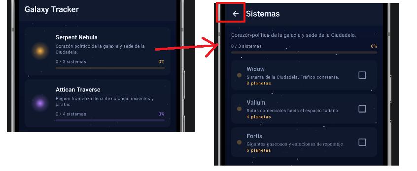

> [!IMPORTANT]
> **🛠️ Paso 5 · En tu app**
>
> 1. Añade la `TopAppBar` en la ranura `topBar` del `Scaffold` de `MassEffectNavigationApp`, y la función `titleFor` debajo.
> 2. Ejecuta. En la lista de galaxias, el título es *Galaxy Tracker* y no hay flecha. En los sistemas, el título es *Sistemas* y aparece la flecha.
> 3. Comprueba que la flecha y el botón Atrás del sistema hacen lo mismo, y que en la lista de galaxias Atrás cierra la app.
>
> Haz commit: `Paso 5: TopAppBar`.

## 7. Sobrevivir al giro: rememberNavBackStack

Haz la prueba: entra en los sistemas de una galaxia y **gira el móvil**. Vuelves a la lista de galaxias.

Es el mismo problema de [T04 · rememberSaveable](T04.md#5-sobrevivir-a-la-rotación-con-remembersaveable): la pila está guardada con `remember`, y `remember` se pierde cuando la Activity se destruye. La solución también se parece:

| Estado de un composable (T04) | Pila de navegación | ¿Sobrevive al giro? |
| :--- | :--- | :---: |
| `remember { mutableStateOf(...) }` | `remember { mutableStateListOf<Any>(...) }` | ❌ |
| `rememberSaveable { mutableStateOf(...) }` | `rememberNavBackStack(...)` | ✅ |

`rememberNavBackStack` guarda la pila al girar y también si el sistema mata el proceso. Para guardarla tiene que poder convertir cada clave en datos, así que todas las claves necesitan dos cosas:

- La anotación **`@Serializable`**, que es lo que añade el plugin de serialización de la [sección 3](#3-dependencias).
- Implementar la interfaz **`NavKey`**. No tiene ningún método: solo marca la clase como clave de navegación.

```kotlin
@Serializable
data object GalaxyList : NavKey

@Serializable
data class SystemList(val galaxyId: Int) : NavKey

@Serializable
data object Progress : NavKey
```

Y en `MassEffectNavigationApp`:

```kotlin
val backStack = rememberNavBackStack(GalaxyList)
```

El resto del código no cambia: `add`, `removeLastOrNull`, `last` y `size` funcionan igual. Lo único es que la pila ahora es de tipo `NavBackStack<NavKey>`, así que `titleFor` recibe un `NavKey` en lugar de un `Any`.

A partir de aquí, **usa siempre `rememberNavBackStack`** en tus apps. La versión con `mutableStateListOf` sirve para entender que la pila no es más que una lista.

> [!WARNING]
> El `@Serializable` bueno es `kotlinx.serialization.Serializable`. Si Android Studio te ofrece `java.io.Serializable`, **no es ese**: compila, pero la app falla en cuanto intenta guardar la pila.

### El estado dentro de cada pantalla

Cuando navegas de la lista de galaxias a los sistemas de una, la lista **sale de la composición**: `NavDisplay` solo compone la cima. ¿Qué pasa con su estado al volver?

- Lo guardado con **`rememberSaveable`** se conserva, porque `NavDisplay` lo guarda para cada destino de la pila. Por ejemplo, la posición del scroll: `LazyColumn` guarda su `LazyListState` ([T06](T06.md#7-controlar-el-scroll-lazyliststate)) con `rememberSaveable`, y al volver la lista de galaxias sigue donde la dejaste.
- Lo guardado con **`remember`** se pierde, igual que cuando un elemento de un `LazyColumn` sale de la pantalla ([T06 · Estado en listas](T06.md#6-estado-en-listas)).

Cuando un destino sale de la pila (vuelves atrás desde él), su estado se borra: si vuelves a entrar, empieza de cero.

> [!IMPORTANT]
> **🛠️ Paso 6 · En tu app**
>
> 1. **Antes de cambiar nada**, comprueba el fallo: abre los sistemas de una galaxia y gira el móvil. Vuelves a la lista de galaxias. Si tienes los `Log.d` del paso 4, mira qué pila sale después del giro.
> 2. Añade `@Serializable` y `: NavKey` a las tres claves de `Keys.kt`. Revisa que el import sea `kotlinx.serialization.Serializable`.
> 3. Cambia la pila por `rememberNavBackStack(GalaxyList)`, y el parámetro de `titleFor` de `Any` a `NavKey`.
> 4. Vuelve a girar en los sistemas de una galaxia: ahora sigues en la misma pantalla, con el mismo título y la flecha.
>
> Haz commit: `Paso 6: rememberNavBackStack`.

## 8. Navegación y ViewModel

Con varias pantallas aparece una pregunta: si marcas Widow como explorado en los sistemas de Serpent Nebula, ¿cómo se enteran la tarjeta de la galaxia y la pantalla de progreso? La respuesta es la de [T07](T07.md): **el estado vive en un ViewModel**, y las pantallas lo pintan.

### Un ViewModel para toda la app

Lo más sencillo es un único ViewModel con los datos de toda la app. Es el patrón de [T07](T07.md#el-patrón-completo-en-viewmodel-y-ui), sin nada nuevo:

```kotlin
data class GalaxyUiState(
    val galaxies: List<Galaxy> = emptyList(),
    val systems: List<StarSystem> = emptyList()
)

class GalaxyViewModel : ViewModel() {
    private val _uiState = MutableStateFlow(GalaxyUiState(GalaxyData.galaxies, GalaxyData.systems))
    val uiState: StateFlow<GalaxyUiState> = _uiState.asStateFlow()

    fun toggleExplored(systemId: Int) {
        _uiState.update { state ->
            state.copy(systems = state.systems.map {
                if (it.id == systemId) it.copy(explored = !it.explored) else it
            })
        }
    }
}
```

Lo importante es **dónde se crea**: fuera del `NavDisplay`.

```kotlin
@Composable
fun MassEffectNavigationApp(viewModel: GalaxyViewModel = viewModel()) {
    val uiState by viewModel.uiState.collectAsStateWithLifecycle()
    val backStack = rememberNavBackStack(GalaxyList)

    // Scaffold y TopAppBar como en la sección 6
    NavDisplay(
        backStack = backStack,
        onBack = { backStack.removeLastOrNull() },
        entryProvider = entryProvider {
            entry<GalaxyList> {
                GalaxyListScreen(
                    galaxies = uiState.galaxies,
                    systems = uiState.systems,
                    onGalaxyClick = { galaxy -> backStack.add(SystemList(galaxy.id)) }
                )
            }
            entry<SystemList> { key ->
                SystemListScreen(
                    galaxy = uiState.galaxies.first { it.id == key.galaxyId },
                    systems = uiState.systems.filter { it.galaxyId == key.galaxyId },
                    onToggleExplored = { system -> viewModel.toggleExplored(system.id) }
                )
            }
            // entry<Progress> igual, con uiState
        }
    )
}
```

- `viewModel()` se llama fuera del `NavDisplay`, así que su dueño es la Activity: **todas las pantallas comparten la misma instancia**, y sobrevive al giro como en T07. Lo que marques en los sistemas se ve en la lista de galaxias y en el progreso.
- Las pantallas siguen sin saber que existe un ViewModel: reciben datos y lambdas. `MassEffectNavigationApp` hace aquí de composable "de nivel pantalla" de T07.
- `SystemList` solo lleva el `galaxyId`, y los sistemas se buscan en el estado actual. Es lo que se explicaba en [Pasar datos a un destino](#pasar-datos-a-un-destino).

Con el estado a mano, la `TopAppBar` de la [sección 6](#6-topappbar-y-botón-arriba) ya puede mostrar el nombre de la galaxia:

```kotlin
title = {
    val top = backStack.last()
    Text(
        if (top is SystemList) uiState.galaxies.first { it.id == top.galaxyId }.name
        else stringResource(titleFor(top))
    )
}
```

Para apps pequeñas, como las del curso, este es el patrón recomendado.

> [!IMPORTANT]
> **🛠️ Paso 7 · En tu app**
>
> 1. En el paquete `ui`, crea `GalaxyUiState.kt` y `GalaxyViewModel.kt`, cada clase en su fichero.
> 2. En `MassEffectNavigationApp`, recibe el ViewModel con `viewModel()` y recoge el estado con `collectAsStateWithLifecycle()`.
> 3. En los tres `entry`, cambia `GalaxyData.galaxies` y `GalaxyData.systems` por `uiState.galaxies` y `uiState.systems`, y conecta `onToggleExplored` con `toggleExplored`.
> 4. Cambia el `title` de la `TopAppBar` para que en los sistemas muestre el nombre de la galaxia.
> 5. Ejecuta. Marca Widow como explorado en Serpent Nebula y vuelve: la tarjeta de la galaxia tiene que contarlo. Gira el móvil: Widow sigue explorado.
>
> Haz commit: `Paso 7: GalaxyViewModel`.

### Un ViewModel por pantalla

A veces una pantalla tiene su propio estado, que no le interesa a nadie más. Imagina que añades una pantalla para escribir notas sobre un sistema (`SystemNotes(systemId)`). Lo lógico es que su ViewModel **nazca al entrar en la pantalla y muera al salir de la pila**.

Para eso hay que añadir un decorador al `NavDisplay`, que da a cada destino de la pila su propio almacén de ViewModels. Es la dependencia `lifecycle-viewmodel-navigation3` de la [sección 3](#3-dependencias):

```kotlin
NavDisplay(
    backStack = backStack,
    onBack = { backStack.removeLastOrNull() },
    entryDecorators = listOf(
        rememberSaveableStateHolderNavEntryDecorator(), // El que viene por defecto: guarda el rememberSaveable de cada pantalla
        rememberViewModelStoreNavEntryDecorator()        // Un almacén de ViewModels para cada pantalla
    ),
    entryProvider = entryProvider {
        // ...
        entry<SystemNotes> { key ->
            val notesViewModel = viewModel { NotesViewModel(key.systemId) }
            val uiState by notesViewModel.uiState.collectAsStateWithLifecycle()
            NotesScreen(
                notes = uiState.notes,
                onNotesChange = { notesViewModel.updateNotes(it) }
            )
        }
    }
)
```

- `viewModel { NotesViewModel(key.systemId) }` crea el ViewModel pasándole el `id` por el constructor. Es otra forma de `viewModel()`, que admite un lambda para construirlo.
- El resto es el patrón de siempre: el `entry` recoge el estado y `NotesScreen` recibe datos y lambdas, **no el ViewModel**. Así la pantalla se puede seguir previsualizando con `@Preview`, como las otras tres.
- Con el decorador, cada `SystemNotes` de la pila tiene **su propio** `NotesViewModel`. Cuando sale de la pila, se llama a su `onCleared()` ([T07](T07.md)).
- **Si pones `entryDecorators`, sustituyes los de por defecto**, así que hay que volver a poner el primero. Si lo olvidas, se pierde el `rememberSaveable` de cada pantalla.

> [!TIP]
> En ejemplos de internet, y también de Google, verás a menudo un composable que recibe el ViewModel, `NotesRoute(viewModel)`. Ese composable recoge el estado y llama a `NotesScreen(uiState, onX)`. No es un error. La regla de Android es que el ViewModel se pide en el composable de nivel pantalla, y que a los de dentro solo les llegan estado y eventos. `NotesRoute` es justo ese composable de nivel pantalla. En este tema ese papel lo hace el `entry`, así que no hace falta.

> [!WARNING]
> Sin el decorador, un `viewModel()` llamado dentro de un `entry` pertenece a la Activity, igual que el de [Un ViewModel para toda la app](#un-viewmodel-para-toda-la-app). Las notas de Widow y las de Sol compartirían **el mismo** ViewModel, y al abrir Sol verías las notas de Widow.

Galaxy Tracker no tiene pantalla de notas, así que esta parte no la aplicas en tu proyecto. Por eso en el paso 2 no añadiste el bloque 4 de dependencias.

## 9. Barra de navegación inferior

Cuando la app tiene varias secciones del mismo nivel, se usa una barra de navegación inferior (`NavigationBar`). Cada botón lleva a un **destino principal**. En Galaxy Tracker son dos: la lista de galaxias y el progreso.

```kotlin
// navigation/TopLevelDestinations.kt, junto a las claves
data class TopLevelDestination(
    val key: NavKey,
    @StringRes val label: Int,
    @DrawableRes val icon: Int
)

// MassEffectNavigationApp.kt
private val TOP_LEVEL_DESTINATIONS = listOf(
    TopLevelDestination(GalaxyList, R.string.galaxies, R.drawable.ic_public),
    TopLevelDestination(Progress, R.string.progress, R.drawable.ic_donut_large)
)
```

La barra va en la ranura `bottomBar` del mismo `Scaffold` de la [sección 6](#6-topappbar-y-botón-arriba):

```kotlin
bottomBar = {
    // El destino principal activo es el último que hay en la pila
    val current = backStack.last { key -> TOP_LEVEL_DESTINATIONS.any { it.key == key } }

    NavigationBar {
        TOP_LEVEL_DESTINATIONS.forEach { destination ->
            NavigationBarItem(
                selected = destination.key == current,
                onClick = { navigateToTopLevel(backStack, destination.key) },
                icon = { Icon(painterResource(destination.icon), contentDescription = null) },
                label = { Text(stringResource(destination.label)) }
            )
        }
    }
}
```

```kotlin
private fun navigateToTopLevel(backStack: NavBackStack<NavKey>, destination: NavKey) {
    while (backStack.size > 1) backStack.removeLastOrNull() // Volvemos al destino de inicio...
    if (destination != GalaxyList) backStack.add(destination) // ...y ponemos encima el elegido
}
```

- **El destino de inicio no cambia**. Si estás en Progreso y pulsas Atrás, vuelves a la lista de galaxias, y desde ahí sales de la app. Es el principio de [Un destino de inicio fijo](#un-destino-de-inicio-fijo).
- Los sistemas de una galaxia se pueden abrir desde las dos secciones. Si los abres desde Progreso, la pila es `[GalaxyList, Progress, SystemList(1)]`, y la barra sigue marcando Progreso porque es el último destino principal de la pila.
- `contentDescription = null` porque la etiqueta ya dice qué es cada botón.
- `ic_public` e `ic_donut_large` vienen en el proyecto. En otra app, son *Vector Assets*: busca `public` y `donut large` en *Clip art*.

Esta versión es sencilla y tiene una pega: al cambiar de sección se pierde lo que tenías abierto en la otra. Si quieres que cada sección conserve su propia pila, mira [Una pila por pestaña](#una-pila-por-pestaña).

> [!IMPORTANT]
> **🛠️ Paso 8 · En tu app**
>
> 1. Crea `navigation/TopLevelDestinations.kt` con la `data class TopLevelDestination`. En `MassEffectNavigationApp.kt`, añade la lista `TOP_LEVEL_DESTINATIONS` y la función `navigateToTopLevel`.
> 2. Añade la `NavigationBar` en la ranura `bottomBar` del `Scaffold`.
> 3. Ejecuta. Pulsa Progreso y, desde ahí, una galaxia: se abren sus sistemas y la barra sigue marcando Progreso. Pulsa Atrás hasta salir: tienes que pasar por Progreso y por la lista de galaxias.
>
> Haz commit: `Paso 8: NavigationBar`.

## 10. Errores frecuentes

- **Importar `java.io.Serializable`** en lugar de `kotlinx.serialization.Serializable`.
- **Olvidar el plugin de serialización.** La anotación `@Serializable` existe igual (viene en `kotlinx-serialization-core`), así que el código compila, pero la app falla al guardar la pila con un error del tipo *"Serializer for class '...' is not found"*.
- **Una clave sin `: NavKey`** con `rememberNavBackStack`: no compila.
- **Vaciar la pila.** `NavDisplay` necesita al menos un elemento.
- **Pasar la pila a las pantallas.** Pasa lambdas (`onGalaxyClick`), y deja que el `entryProvider` decida a dónde se va.
- **Meter objetos enteros en la clave** en lugar de su `id`: la pantalla mostrará una copia vieja de los datos.
- **`viewModel()` dentro de un `entry` sin el decorador** cuando querías un ViewModel por pantalla: todas las pantallas del mismo tipo comparten el mismo.
- **Poner `entryDecorators` sin `rememberSaveableStateHolderNavEntryDecorator()`**: las pantallas pierden su `rememberSaveable`, por ejemplo la posición del scroll.
- **Un `Scaffold` dentro de cada pantalla además del global**: las barras del sistema se cuentan dos veces y aparecen huecos raros arriba o abajo. Con la barra global, las pantallas no llevan `Scaffold`.
- **El doble toque.** Si el usuario pulsa dos veces muy rápido, se apila dos veces el mismo destino. En los ejemplos oficiales se evita envolviendo el `onClick` con `dropUnlessResumed { }` (de `lifecycle-runtime-compose`), que ignora los toques mientras la pantalla todavía está en transición: `onClick = dropUnlessResumed { onGalaxyClick(galaxy) }`.
- **Copiar código de Navigation 2** de un *codelab*, de un tutorial o de una IA: si ves `NavHost`, `navController` o imports de `androidx.navigation.compose`, es la otra biblioteca. Mira la tabla de la sección siguiente.

## 11. Si te encuentras Navigation 2

Buena parte de lo que encuentres por Internet, incluidos los *codelabs* de Cupcake y Lunch Tray, usa Navigation 2. Esta tabla te ayuda a leerlo y a traducirlo:

| Navigation 2 | Navigation 3 |
| :--- | :--- |
| `val navController = rememberNavController()` | `val backStack = rememberNavBackStack(GalaxyList)` |
| `NavHost(navController, startDestination = GalaxyList) { ... }` | `NavDisplay(backStack, entryProvider = entryProvider { ... })` |
| `composable<SystemList> { entry -> entry.toRoute<SystemList>().galaxyId }` | `entry<SystemList> { key -> key.galaxyId }` |
| `navController.navigate(SystemList(1))` | `backStack.add(SystemList(1))` |
| `navController.popBackStack()` y `navController.navigateUp()` | `backStack.removeLastOrNull()` |
| `navController.currentBackStackEntryAsState()` | `backStack.last()` |
| `navController.previousBackStackEntry != null` (¿mostrar Arriba?) | `backStack.size > 1` |
| `navigate(...) { popUpTo(...) { inclusive = true } }`, `launchSingleTop` | Operaciones de lista ([sección 5](#5-navegar-es-modificar-una-lista)) |
| `navigation(...) { }` (grafos anidados) | No hace falta: no hay grafo |
| `dialog<T> { }` | `entry<T>(metadata = DialogSceneStrategy.dialog()) { }` ([Diálogos como destino](#diálogos-como-destino)) |
| Rutas `String` (`CupcakeScreen.Start.name`) | Claves con tipo (`data object`, `data class`) |
| Dependencia `navigation-compose` | `navigation3-runtime` y `navigation3-ui` |

Si algún día tienes que pasar una app de Navigation 2 a Navigation 3, Google tiene una [guía de migración](https://developer.android.com/guide/navigation/navigation-3/migration-guide) paso a paso.

-----

## Entrega: Galaxy Tracker 🚨

Se entrega tu Galaxy Tracker, el que has ido implementando en los pasos del tema. Si has hecho los ocho, ya está terminado. Antes de entregarlo, repasa que todo funciona junto.

Entrega el enlace a GitHub de tu repositorio `T08-galaxy-tracker`.

### Comprobaciones

- [ ] Al pulsar una galaxia, desde Galaxias o desde Progreso, se abren sus sistemas.
- [ ] La `TopAppBar` muestra el nombre de la galaxia en sus sistemas, y la flecha solo aparece si se puede volver.
- [ ] Al marcar un sistema como explorado, el cambio se ve en la tarjeta de su galaxia y en Progreso.
- [ ] **Nada se pierde al girar el móvil**: ni la pantalla en la que estás ni los sistemas explorados.
- [ ] Desde cualquier pantalla, pulsando Atrás acabas en la lista de galaxias, y desde ahí se cierra la app.
- [ ] En el `README.md` del repositorio respondes en dos líneas: *Abre los sistemas de una galaxia desde Progreso, cambia a Galaxias y vuelve a Progreso. ¿Qué ha pasado con la pantalla que tenías abierta? ¿Por qué?* La pista está al final de la [sección 9](#9-barra-de-navegación-inferior).
- [ ] El historial tiene un commit por paso.

### Mejoras opcionales

- Animaciones al navegar ([Animaciones](#animaciones)).
- `dropUnlessResumed` en las tarjetas, para que un doble toque no apile dos veces la misma pantalla ([Errores frecuentes](#10-errores-frecuentes)).
- Un `IconButton` en las `actions` de la `TopAppBar`, solo en los sistemas de una galaxia, que los marque todos como explorados.
- Que Galaxias y Progreso conserven cada uno su pila ([Una pila por pestaña](#una-pila-por-pestaña)). Si lo haces, actualiza la respuesta del README.

## Para ampliar

Nada de esto es necesario para las apps del curso. Aquí tienes por dónde seguir si quieres más.

### Animaciones

`NavDisplay` ya anima el cambio de pantalla. Puedes cambiar la animación con `transitionSpec` (al navegar hacia delante), `popTransitionSpec` (al volver) y `predictivePopTransitionSpec` (durante el gesto de atrás predictivo):

```kotlin
NavDisplay(
    // ...
    transitionSpec = {
        slideInHorizontally(initialOffsetX = { it }) togetherWith slideOutHorizontally(targetOffsetX = { -it })
    },
    popTransitionSpec = {
        slideInHorizontally(initialOffsetX = { -it }) togetherWith slideOutHorizontally(targetOffsetX = { it })
    }
)
```

También se puede dar una animación distinta a un solo destino con los `metadata` del `entry`. Todo en [Animate between destinations](https://developer.android.com/guide/navigation/navigation-3/animate-destinations).

### Diálogos como destino

En [T05 · Diálogos](T05.md#5-diálogos) el diálogo se mostraba con un `Boolean`, y para la mayoría de los casos es lo más sencillo. Pero un diálogo también puede ser un destino de la pila, con su clave. Es útil cuando el diálogo es un "sitio" al que se navega, por ejemplo uno para confirmar el salto por un relé de masa:

```kotlin
val dialogStrategy = remember { DialogSceneStrategy<NavKey>() }

NavDisplay(
    backStack = backStack,
    sceneStrategies = listOf(dialogStrategy),
    entryProvider = entryProvider {
        // ...
        entry<ConfirmJump>(metadata = DialogSceneStrategy.dialog()) { key ->
            ConfirmJumpDialog(systemId = key.systemId)
        }
    }
)
```

Al pulsar fuera o Atrás, la clave sale de la pila y el diálogo se cierra. Receta completa: [dialog](https://github.com/android/nav3-recipes/tree/main/app/src/main/java/com/example/nav3recipes/dialog).

### Devolver un resultado

A veces una pantalla sirve para elegir algo y devolverlo a la anterior, como un selector de sistema. En una app pequeña lo más fácil es el [ViewModel compartido](#un-viewmodel-para-toda-la-app): la pantalla que elige se lo dice al ViewModel y vuelve atrás. Desde la versión 1.2, Navigation 3 tiene además una API propia, `ResultEventBus`: [Return results](https://developer.android.com/guide/navigation/navigation-3/return-results).

### Una pila por pestaña

Con la barra de la [sección 9](#9-barra-de-navegación-inferior), al cambiar de sección se pierde lo que tenías abierto en la otra. Apps como YouTube o Instagram guardan **una pila para cada pestaña**. Con Navigation 3 se hace con una pila por destino principal y una clase que decide cuál se muestra. Google lo tiene resuelto en la receta [multiplestacks](https://github.com/android/nav3-recipes/tree/main/app/src/main/java/com/example/nav3recipes/multiplestacks), y la [guía de migración](https://developer.android.com/guide/navigation/navigation-3/migration-guide) trae las dos clases (`NavigationState` y `Navigator`) listas para copiar.

### Pantallas grandes: escenas

En una tablet o en un móvil plegable cabe más de una pantalla a la vez: la lista de galaxias a la izquierda y los sistemas a la derecha. Navigation 3 lo resuelve con **escenas** (`Scene`): una escena decide cuántas entradas de la cima de la pila se muestran y cómo se colocan. Lo que has hecho en este tema usa la escena por defecto, que muestra solo la cima. Más en [Create custom layouts using Scenes](https://developer.android.com/guide/navigation/navigation-3/custom-layouts) y en la receta [material/listdetail](https://github.com/android/nav3-recipes/tree/main/app/src/main/java/com/example/nav3recipes/material/listdetail).

### Deep links

Abrir la app en un destino concreto desde un enlace, construyendo la pila completa como pide el [principio de los enlaces profundos](#enlaces-profundos): [Support deep links](https://developer.android.com/guide/navigation/navigation-3/deep-links).

### Más lecturas

- [Principles of navigation](https://developer.android.com/guide/navigation/principles): los principios de la [sección 1](#1-principios-de-navegación), con el ejemplo de la app Sunflower.
- [Navigation 3](https://developer.android.com/guide/navigation/navigation-3): la guía oficial. Las páginas [Understand and implement the basics](https://developer.android.com/guide/navigation/navigation-3/basics) y [Save and manage navigation state](https://developer.android.com/guide/navigation/navigation-3/save-state) son las que corresponden a este tema.
- [nav3-recipes](https://github.com/android/nav3-recipes): un ejemplo pequeño y completo para cada caso. Empieza por `basic`, `basicsaveable` y `basicdsl`.
- [Announcing Jetpack Navigation 3](https://android-developers.googleblog.com/2025/05/announcing-jetpack-navigation-3-for-compose.html): la entrada del blog en la que Google explica por qué hizo una biblioteca nueva.
- [Navigate between screens with Compose](https://developer.android.com/codelabs/basic-android-kotlin-compose-navigation) (app Cupcake) y [Practice: Add navigation](https://developer.android.com/codelabs/basic-android-kotlin-compose-practice-navigation) (app Lunch Tray): los *codelabs* del curso oficial, **con Navigation 2**. Siguen sirviendo para ver un ViewModel compartido entre pantallas y una `TopAppBar` con botón Arriba. Con la tabla de la [sección 11](#11-si-te-encuentras-navigation-2) puedes hacerlos con Navigation 3, pero tendrás que actualizar antes las versiones del proyecto (el *starter* usa `compileSdk` 35).
- Guías de Material 3 para la [barra de navegación](https://m3.material.io/components/navigation-bar/overview) y la [barra superior](https://m3.material.io/components/app-bars/overview): cuándo usar cada patrón.
